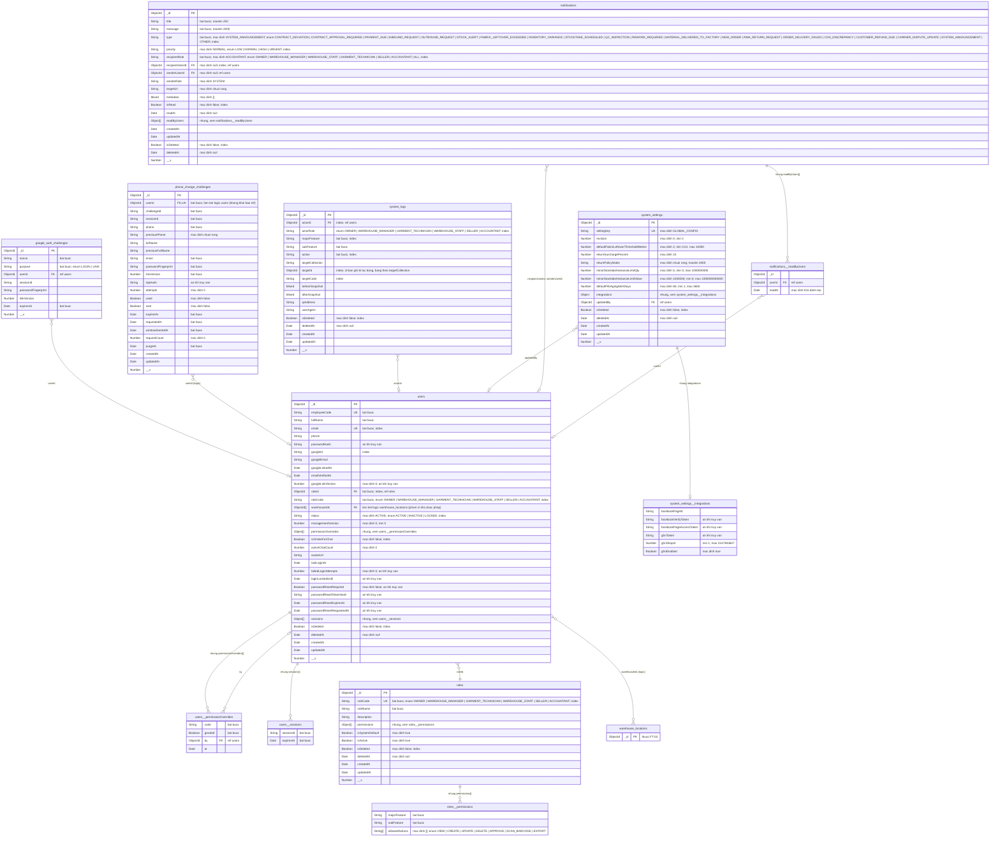
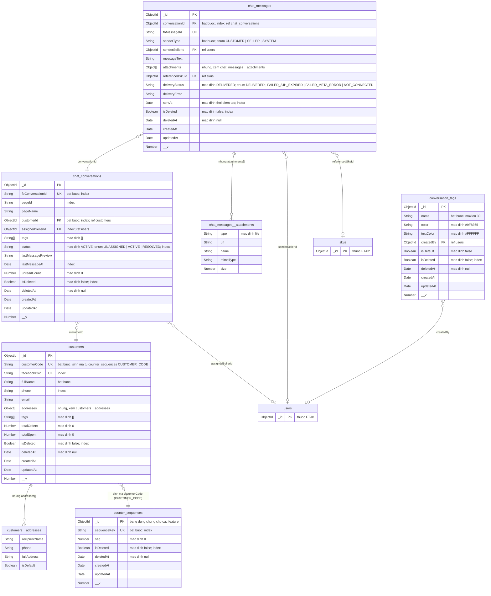

# ARAWMS – Database Design theo 11 feature

Sinh tự động từ Mongoose models (`ARAWMS_BE/src/models`), ngày 2026-11-25.

- 53 collection: 52 bảng thuộc đúng một feature, liệt kê **đầy đủ mọi thuộc tính** (kể cả `_id`, `__v`, `isDeleted`, `deletedAt`, `createdAt`, `updatedAt` nếu bảng có).
- `counter_sequences` là **bảng dùng chung** (bộ đếm sinh mã chứng từ), không thuộc riêng feature nào: được vẽ đủ thuộc tính trong mọi feature có bảng lấy mã từ nó.
- Đối tượng lồng / mảng nhúng tách thành thực thể con `bang__truong` (MongoDB lưu chung trong document cha), nối với cha bằng quan hệ `nhung`.
- Ghi chú thuộc tính: `bat buoc`, `mac dinh`, `enum`, `min/max`, `index`, `an khi truy van`, `ref`, `lien ket logic`, `sinh ma tu counter_sequences`.
- Mọi quan hệ là **nét liền**. Nhãn `(logic)` = liên kết không khai báo `ref` / đa hình; nhãn `sinh ma ...` = trường mã lấy số thứ tự từ `counter_sequences`.
- Bảng thuộc feature khác chỉ hiện `_id` kèm feature gốc.

Cách dùng với draw.io: copy nội dung **bên trong** một khối `mermaid` (từ dòng `erDiagram`), vào Arrange → Insert → Advanced → Mermaid.

## FT-01 – System Administration

Collection: `users`, `roles`, `google_auth_challenges`, `phone_change_challenges`, `system_logs`, `system_settings`, `notifications` · 12 thực thể (gồm phần nhúng) · 148 thuộc tính



## FT-02 – Master Data Management

Collection: `warehouse_layouts`, `warehouse_locations`, `warehouse_barcode_history`, `products`, `skus`, `catalog_operations`, `raw_materials`, `material_categories` · 17 thực thể (gồm phần nhúng) · 201 thuộc tính

```mermaid
erDiagram
  %% FT-02 Master Data Management
  warehouse_layouts {
    ObjectId _id PK
    String warehouseType UK "bat buoc; mac dinh FINISHED_GOODS"
    Number activeVersion "mac dinh 0"
    Object active "nhung, xem warehouse_layouts__active"
    Object draft "nhung, xem warehouse_layouts__draft"
    Number draftBaseVersion
    Number draftVersion "mac dinh 0"
    ObjectId updatedByUserId FK "ref users"
    ObjectId publishedByUserId FK "ref users"
    Date publishedAt
    Date createdAt
    Date updatedAt
    Number __v
  }
  warehouse_layouts__active {
    Object[] zones "nhung, xem warehouse_layouts__active__zones"
    Object[] racks "nhung, xem warehouse_layouts__active__racks"
    Object[] bins "nhung, xem warehouse_layouts__active__bins"
    Number nearFullThreshold
  }
  warehouse_layouts__active__zones {
    String code
    String name
    String type
    String status
    String note
  }
  warehouse_layouts__active__racks {
    ObjectId id "id ke noi bo"
    String code
    String name
    String zoneCode
    String status
    String note
    Number floors
    Number binsPerFloor
  }
  warehouse_layouts__active__bins {
    ObjectId id FK "lien ket logic warehouse_locations (o ke = vi tri kho)"
    ObjectId rackId "tro toi active.racks.id"
    String locationCode
    String displayName
    String barcode
    Number floorNo
    Number binNo
    Number capacity
    String capacityUnit
    String allowedSkuMode
    ObjectId[] allowedSkuIds FK "mac dinh []; lien ket logic skus (SKU duoc phep)"
    String status
    String note
  }
  warehouse_layouts__draft {
    Object[] zones "nhung, xem warehouse_layouts__draft__zones"
    Object[] racks "nhung, xem warehouse_layouts__draft__racks"
    Object[] bins "nhung, xem warehouse_layouts__draft__bins"
    Number nearFullThreshold
  }
  warehouse_layouts__draft__zones {
    String code
    String name
    String type
    String status
    String note
  }
  warehouse_layouts__draft__racks {
    ObjectId id "id ke noi bo"
    String code
    String name
    String zoneCode
    String status
    String note
    Number floors
    Number binsPerFloor
  }
  warehouse_layouts__draft__bins {
    ObjectId id FK "lien ket logic warehouse_locations (o ke = vi tri kho)"
    ObjectId rackId "tro toi draft.racks.id"
    String locationCode
    String displayName
    String barcode
    Number floorNo
    Number binNo
    Number capacity
    String capacityUnit
    String allowedSkuMode
    ObjectId[] allowedSkuIds FK "mac dinh []; lien ket logic skus (SKU duoc phep)"
    String status
    String note
  }
  warehouse_locations {
    ObjectId _id PK
    String locationCode UK "bat buoc"
    String barcode UK "bat buoc; index"
    String warehouseType "bat buoc; enum RAW_MATERIAL | FINISHED_GOODS | DEFECT_QUARANTINE; index"
    String zoneCode "bat buoc; index"
    String rackCode "bat buoc"
    String rackName
    String shelfCode "bat buoc"
    Number fifoPickSequence "mac dinh 1"
    Number maxCapacity "bat buoc"
    String capacityUnit
    Number currentOccupancy "mac dinh 0"
    Boolean isFrozenForStocktake "mac dinh false; index"
    String status "mac dinh ACTIVE; enum ACTIVE | FULL | MAINTENANCE | LOCKED | INACTIVE"
    Boolean layoutBin "mac dinh false; index"
    Boolean isSystemUnplaced "mac dinh false"
    String displayName
    Number floorNo
    Number binNo
    String allowedSkuMode "mac dinh SINGLE; enum SINGLE | MULTI"
    ObjectId[] allowedSkuIds FK "mac dinh []; ref skus"
    Number plannedReservedQty "mac dinh 0; min 0"
    Number layoutVersion "mac dinh 0"
    Boolean isDeleted "mac dinh false; index"
    Date deletedAt "mac dinh null"
    Date createdAt
    Date updatedAt
    Number __v
  }
  warehouse_barcode_history {
    ObjectId _id PK
    String barcode UK "bat buoc"
    ObjectId locationId FK "bat buoc; ref warehouse_locations"
    Date revokedAt
    String reason
    Date createdAt
    Date updatedAt
    Number __v
  }
  products {
    ObjectId _id PK
    String productCode UK "bat buoc; index"
    String productName "bat buoc"
    String description "maxlen 2000"
    String[] additionalImageUrls "mac dinh []"
    String configurationRequestId UK
    String sampleCode
    String category "bat buoc"
    String season
    Number basePrice "bat buoc; min 0"
    String thumbnailUrl
    String imagePublicId
    String videoUrl
    String videoPublicId
    Object[] mediaOperations "nhung, xem products__mediaOperations"
    Boolean isActive "mac dinh true"
    Date codeLockedAt "mac dinh null"
    Boolean isDeleted "mac dinh false; index"
    Date deletedAt "mac dinh null"
    Date createdAt
    Date updatedAt
    Number version
  }
  products__mediaOperations {
    ObjectId _id
    ObjectId ownerUserId FK "lien ket logic users (khong khai bao ref)"
    String operationId
    String sha256
    String kind
    String url
  }
  skus {
    ObjectId _id PK
    String skuCode UK "bat buoc; index"
    String skuBarcode UK "bat buoc; index"
    ObjectId productId FK "bat buoc; index; ref products"
    String styleName "bat buoc"
    String color "bat buoc"
    String variantKey UK
    String size "bat buoc; enum XS | S | M | L | XL | XXL | FREESIZE"
    Number retailPrice "bat buoc; min 0"
    Number unitCogs "bat buoc; mac dinh 0; min 0"
    Number onHandQty "mac dinh 0; min 0"
    Number reservedQty "mac dinh 0; min 0"
    Number safetyStockThreshold "mac dinh 10"
    Number fifoAgingThresholdDays "mac dinh 60"
    Boolean isActive "mac dinh true"
    Date discontinuedAt "mac dinh null"
    Boolean isDeleted "mac dinh false; index"
    Date deletedAt "mac dinh null"
    Date createdAt
    Date updatedAt
    Number version
  }
  catalog_operations {
    ObjectId _id PK
    ObjectId ownerUserId FK "bat buoc; ref users"
    String operationId "bat buoc"
    String payloadHash "bat buoc"
    Mixed result "bat buoc"
    Date createdAt
    Date updatedAt
    Number __v
  }
  raw_materials {
    ObjectId _id PK
    String materialCode UK "bat buoc; index; sinh ma tu counter_sequences RAW_MATERIAL_CODE"
    String materialName "bat buoc"
    String materialType "bat buoc; enum FABRIC | AUXILIARY; index"
    String category FK "bat buoc; index; lien ket logic material_categories (category = categoryCode)"
    String unit "bat buoc"
    String color
    Number gsm
    Number widthCm
    Boolean requiresWeightKg "mac dinh false"
    Number unitCost "bat buoc; min 0"
    Number onHandQty "mac dinh 0; min 0"
    Number pendingPutawayQty "mac dinh 0; min 0"
    Number reservedQty "mac dinh 0; min 0"
    Number safetyStockThreshold "mac dinh 50"
    Number fifoAgingThresholdDays "mac dinh 90"
    ObjectId supplierId FK "mac dinh null; index; ref suppliers"
    Boolean isActive "mac dinh true"
    Boolean isDeleted "mac dinh false; index"
    Date deletedAt "mac dinh null"
    Date createdAt
    Date updatedAt
    Number version
  }
  material_categories {
    ObjectId _id PK
    String categoryCode UK "bat buoc; index; sinh ma tu counter_sequences MATERIAL_CATEGORY_CODE"
    String categoryName "bat buoc"
    String materialType "bat buoc; enum FABRIC | AUXILIARY; index"
    String description "mac dinh chuoi rong"
    Number displayOrder "mac dinh 0"
    Boolean isActive "mac dinh true"
    Date createdAt
    Date updatedAt
    Boolean isDeleted "mac dinh false; index"
    Date deletedAt "mac dinh null"
    Number __v
  }
  users {
    ObjectId _id PK "thuoc FT-01"
  }
  counter_sequences {
    ObjectId _id PK "bang dung chung cho cac feature"
    String sequenceKey UK "bat buoc; index"
    Number seq "mac dinh 0"
    Boolean isDeleted "mac dinh false; index"
    Date deletedAt "mac dinh null"
    Date createdAt
    Date updatedAt
    Number __v
  }
  suppliers {
    ObjectId _id PK "thuoc FT-03"
  }
  fabric_rolls {
    ObjectId _id PK "thuoc FT-05; bang trung gian noi cac nhom"
  }
  warehouse_layouts ||--o| warehouse_layouts__active : "nhung active"
  warehouse_layouts ||--o| warehouse_layouts__draft : "nhung draft"
  warehouse_layouts__active ||--o{ warehouse_layouts__active__zones : "nhung zones[]"
  warehouse_layouts__active ||--o{ warehouse_layouts__active__racks : "nhung racks[]"
  warehouse_layouts__active ||--o{ warehouse_layouts__active__bins : "nhung bins[]"
  warehouse_layouts__draft ||--o{ warehouse_layouts__draft__zones : "nhung zones[]"
  warehouse_layouts__draft ||--o{ warehouse_layouts__draft__racks : "nhung racks[]"
  warehouse_layouts__draft ||--o{ warehouse_layouts__draft__bins : "nhung bins[]"
  products ||--o{ products__mediaOperations : "nhung mediaOperations[]"
  warehouse_layouts }o--o| users : "updatedByUserId, publishedByUserId"
  warehouse_layouts__active__bins }o--o| warehouse_locations : "id (logic)"
  warehouse_layouts__active__bins }o--o{ skus : "allowedSkuIds (logic)"
  warehouse_layouts__draft__bins }o--o| warehouse_locations : "id (logic)"
  warehouse_layouts__draft__bins }o--o{ skus : "allowedSkuIds (logic)"
  warehouse_locations }o--o{ skus : "allowedSkuIds"
  warehouse_barcode_history }o--|| warehouse_locations : "locationId"
  products__mediaOperations }o--o| users : "ownerUserId (logic)"
  skus }o--|| products : "productId"
  catalog_operations }o--|| users : "ownerUserId"
  raw_materials }o--|| counter_sequences : "sinh ma materialCode (RAW_MATERIAL_CODE)"
  raw_materials }o--o| material_categories : "category (logic)"
  raw_materials }o--o| suppliers : "supplierId"
  material_categories }o--|| counter_sequences : "sinh ma categoryCode (MATERIAL_CATEGORY_CODE)"
  users }o--o{ warehouse_locations : "warehouseIds (logic)"
  fabric_rolls }o--|| raw_materials : "rawMaterialId"
  fabric_rolls }o--o| suppliers : "supplierId"
  fabric_rolls }o--o| warehouse_locations : "locationId"
```



## FT-03 – Supplier Contract Governance

Collection: `suppliers`, `supplier_contracts`, `material_inbound_plans` · 31 thực thể (gồm phần nhúng) · 302 thuộc tính

```mermaid
erDiagram
  %% FT-03 Supplier Contract Governance
  suppliers {
    ObjectId _id PK
    String supplierCode UK "bat buoc"
    String supplierName "bat buoc"
    String taxCode
    String representativeName "mac dinh chuoi rong"
    String representativeRole "mac dinh Giám đốc"
    String contactName
    String phone "bat buoc"
    String email
    String address
    String supplyCategory "mac dinh BOTH; enum FABRIC | AUXILIARY | BOTH"
    Number paymentTermDays "mac dinh 30; min 0"
    Number leadTimeDays "mac dinh 7; min 0"
    Object bankInfo "nhung, xem suppliers__bankInfo"
    String notes "mac dinh chuoi rong"
    Number totalPayableDebt "mac dinh 0; min 0"
    Boolean isActive "mac dinh true"
    Boolean isDeleted "mac dinh false; index"
    Date deletedAt "mac dinh null"
    Date createdAt
    Date updatedAt
    Number __v
  }
  suppliers__bankInfo {
    String bankName
    String accountNo
    String accountHolder
    String branchName
  }
  supplier_contracts {
    ObjectId _id PK
    String contractCode UK "bat buoc; index"
    String contractTitle "mac dinh khung hợp đồng cung ứng nguyên phụ liệu may mặc"
    String contractType "mac dinh FRAMEWORK_AGREEMENT; enum SALES_CONTRACT | FRAMEWORK_AGREEMENT | BATCH_LUMP_SUM | FIXED_UNIT_PRICE"
    Date signingDate "mac dinh thoi diem tao"
    Date effectiveFrom "mac dinh thoi diem tao"
    Date effectiveTo "mac dinh thoi diem tao"
    ObjectId supplierId FK "bat buoc; index; ref suppliers"
    ObjectId parentSupersededContractId FK "mac dinh null; ref supplier_contracts"
    ObjectId rootContractId FK "mac dinh null; index; ref supplier_contracts"
    Number versionNumber "mac dinh 1; min 1; index"
    String amendmentReason "mac dinh chuoi rong"
    String status "mac dinh DRAFT_FRAMEWORK; enum DRAFT_FRAMEWORK | ACTIVE | DEVIATION_FLAGGED | SUPERSEDED | COMPLETED | TERMINATED | CANCELLED; index"
    ObjectId draftedByAccountantId FK "bat buoc; ref users"
    ObjectId finalizedByOwnerId FK "ref users"
    Date finalizedAt
    Object buyerInfo "nhung, xem supplier_contracts__buyerInfo"
    Object commercialTerms "nhung, xem supplier_contracts__commercialTerms"
    Object qualityStandards "nhung, xem supplier_contracts__qualityStandards"
    String frameworkDocumentUrl "mac dinh chuoi rong"
    String signedContractDocumentUrl "mac dinh chuoi rong"
    Number totalContractAmount "bat buoc; min 0"
    Number totalPaidAmount "mac dinh 0; min 0"
    Number latePenaltyPercentPerDay "mac dinh 0.5; min 0"
    Number maxPenaltyPercent "mac dinh 8; min 0"
    String breachPenaltyClause "mac dinh Giao chậm phạt 0.5%/ngày trên giá trị lô hàng chậm tiến độ (tối đa 8%). Nếu vải/phụ liệu không đạt kiểm định KCS (sai khổ vải, lệch định lượng GSM, độ co rút vượt ngưỡng hoặc lỗi ngoại quan > 20 điểm/100 sq.yds), Bên B phải đổi trả 100% trong vòng 5 ngày làm việc và chịu toàn bộ chi phí vận chuyển hai chiều."
    String disputeResolutionClause "mac dinh Mọi tranh chấp phát sinh được ưu tiên giải quyết qua thương lượng trên cơ sở Biên bản KCS thực tế tại kho Bên A; nếu không đạt thỏa thuận sẽ đưa ra Tòa án Kinh tế có thẩm quyền tại TP.HCM."
    String notes "mac dinh chuoi rong"
    Date terminatedAt "mac dinh null"
    ObjectId terminatedByUserId FK "mac dinh null; ref users"
    String terminationReason "mac dinh chuoi rong"
    Boolean isAutoTerminated "mac dinh false"
    Object[] contractedMaterials "nhung, xem supplier_contracts__contractedMaterials"
    Boolean isDeleted "mac dinh false; index"
    Date deletedAt "mac dinh null"
    Date createdAt
    Date updatedAt
    Number __v
  }
  supplier_contracts__buyerInfo {
    String companyName "mac dinh CÔNG TY TNHH THỜI TRANG & KHO VẬN ARA (ARASTORE)"
    String taxCode "mac dinh 0109888999"
    String representativeName "mac dinh Trần Hoàng Chủ Tịch"
    String representativeRole "mac dinh Chủ sở hữu / Giám đốc"
    String receivingWarehouseAddress "mac dinh Kho Tổng Nguyên Phụ Liệu AraStore – KCN Tân Bình, TP.HCM"
  }
  supplier_contracts__commercialTerms {
    String currency "mac dinh VND"
    Number subtotalAmount "mac dinh 0; min 0"
    Number vatRatePct "mac dinh 8; min 0"
    Number vatAmount "mac dinh 0; min 0"
    Number depositPercent "mac dinh 30; min 0; max 100"
    Number depositAmount "mac dinh 0; min 0"
    Number paymentInstallmentsCount "mac dinh 1; min 0; max 12"
    Object[] paymentSchedule "nhung, xem supplier_contracts__commercialTerms__paymentSchedule"
    String paymentMethod "mac dinh BANK_TRANSFER; enum BANK_TRANSFER | CASH | LETTER_OF_CREDIT"
    Number paymentCreditDays "mac dinh 30; min 0"
    String deliveryTerm "mac dinh GIAO_TAI_KHO_BEN_A; enum GIAO_TAI_KHO_BEN_A | GIAO_TAI_XUONG_MAY | NHAN_TAI_KHO_NCC"
    Boolean partialDeliveryAllowed "mac dinh true"
  }
  supplier_contracts__commercialTerms__paymentSchedule {
    ObjectId _id
    Number installmentNumber "bat buoc; min 1"
    Date dueDate "bat buoc"
    Number paymentPercent "bat buoc; min 0; max 100"
    Number paymentAmount "mac dinh 0; min 0"
    String note "mac dinh chuoi rong"
  }
  supplier_contracts__qualityStandards {
    String inspectionStandard "mac dinh Hệ thống 4 điểm (ASTM D5430 4-Point System) đối với vải cuộn; AQL 2.5 đối với phụ liệu may"
    Number maxDefectPointsPer100SqYards "mac dinh 20; min 0"
    Number maxRollJoints "mac dinh 1; min 0"
    Boolean requirePreShipmentSample "mac dinh true"
    Number returnExchangeWarrantyDays "mac dinh 15; min 0"
  }
  supplier_contracts__contractedMaterials {
    ObjectId rawMaterialId FK "bat buoc; ref raw_materials"
    String materialCodeSnapshot "mac dinh chuoi rong"
    String materialNameSnapshot "mac dinh chuoi rong"
    String unitSnapshot "mac dinh METER"
    String composition "mac dinh 100% Cotton"
    String colorSpec "mac dinh chuoi rong"
    Number widthCm "mac dinh 160; min 0"
    Number gsm "mac dinh 200; min 0"
    Number shrinkageTolerancePct "mac dinh 2.5; min 0"
    String colorFastnessGrade "mac dinh Grade 4.0 (ISO 105)"
    Number qtyTolerancePct "mac dinh 3; min 0"
    Number moq "mac dinh 100; min 1"
    Number leadTimeDays "mac dinh 7; min 1"
    Number contractedQty "bat buoc; min 1"
    Number rollCount "mac dinh 0; min 0"
    Object[] rollDetails "nhung, xem supplier_contracts__contractedMaterials__rollDetails"
    Number unitPrice "bat buoc; min 0"
    Number vatRatePct "mac dinh 8; min 0"
    String packagingSpec "mac dinh Cuộn bọc nilon 2 lớp chống ẩm, lõi ống giấy cứng, dán tem Barcode từng cây vải"
    String technicalNote "mac dinh chuoi rong"
  }
  supplier_contracts__contractedMaterials__rollDetails {
    Number rollIndex "bat buoc"
    String rollCode "mac dinh chuoi rong"
    Number rollQty "mac dinh 1; min 1"
    Number lengthMeters "bat buoc; min 0"
    Number weightKg "mac dinh 0"
    String note "mac dinh chuoi rong"
  }
  material_inbound_plans {
    ObjectId _id PK
    String planCode UK "bat buoc; index; sinh ma tu counter_sequences MATERIAL_DELIVERY_PLAN"
    ObjectId contractId FK "index; ref supplier_contracts"
    ObjectId supplierId FK "bat buoc; index; ref suppliers"
    Number totalBatches "mac dinh 1; min 1"
    Object[] batches "nhung, xem material_inbound_plans__batches"
    Object[] deliveryBatches "nhung, xem material_inbound_plans__deliveryBatches"
    ObjectId warehouseLocationId FK "index; ref warehouse_locations"
    Number deliveryVersion "mac dinh 0"
    Object[] deliveryHistory "nhung, xem material_inbound_plans__deliveryHistory"
    String deliveryNote
    Date scheduledDeliveryDate "bat buoc; index"
    String status "mac dinh SCHEDULED; enum SCHEDULED | IN_INSPECTION | VERIFIED_MATCHED | DEVIATION_REPORTED | RESOLVED_SUPERSEDED | CANCELLED; index"
    String deliveryComplianceStatus "mac dinh PENDING; enum PENDING | MATCHED | MISMATCHED; index"
    ObjectId createdByAccountantId FK "bat buoc; ref users"
    ObjectId assignedReceiverId FK "ref users"
    ObjectId assignedBuyerId FK "ref users"
    Number assignmentRevision "mac dinh 0; min 0"
    String[] physicalContractPhotos "mac dinh []"
    ObjectId parentSupersededPlanId FK "mac dinh null; ref material_inbound_plans"
    ObjectId rootPlanId FK "mac dinh null; index; ref material_inbound_plans"
    Number versionNumber "mac dinh 1; min 1; index"
    String amendmentReason "mac dinh chuoi rong"
    String notes "mac dinh chuoi rong"
    Object[] expectedItems "nhung, xem material_inbound_plans__expectedItems"
    Number batchNumber "mac dinh 1; min 1; index"
    String batchTitle "mac dinh chuoi rong"
    Number batchPercentage "mac dinh 100; min 0; max 100"
    Object technicianVerification "nhung, xem material_inbound_plans__technicianVerification"
    Object deviationResolution "nhung, xem material_inbound_plans__deviationResolution"
    Object reportedToOwner "nhung, xem material_inbound_plans__reportedToOwner"
    Boolean isDeleted "mac dinh false; index"
    Date deletedAt "mac dinh null"
    Date createdAt
    Date updatedAt
    Number __v
  }
  material_inbound_plans__batches {
    ObjectId _id
    Number batchNumber "mac dinh 1"
    String batchTitle "mac dinh chuoi rong"
    Number batchPercentage "mac dinh 50"
    Date scheduledDeliveryDate "bat buoc"
    String notes "mac dinh chuoi rong"
    String status "mac dinh SCHEDULED; enum SCHEDULED | IN_INSPECTION | VERIFIED_MATCHED | DEVIATION_REPORTED | RESOLVED_SUPERSEDED | CANCELLED"
    ObjectId assignedReceiverId FK "ref users"
    ObjectId assignedBuyerId FK "ref users"
    Object[] expectedItems "nhung, xem material_inbound_plans__batches__expectedItems"
    String deliveryComplianceStatus "mac dinh PENDING; enum PENDING | MATCHED | MISMATCHED"
    Object technicianVerification "nhung, xem material_inbound_plans__batches__technicianVerification"
    Object deviationResolution "nhung, xem material_inbound_plans__batches__deviationResolution"
  }
  material_inbound_plans__batches__expectedItems {
    ObjectId rawMaterialId FK "bat buoc; ref raw_materials"
    Number plannedQty "bat buoc"
    String unitSnapshot "mac dinh METER"
    Number rollCount "mac dinh 0; min 0"
    Object[] rollDetails "nhung, xem material_inbound_plans__batches__expectedItems__rollDetails"
    Object[] selectedRolls "nhung, xem material_inbound_plans__batches__expectedItems__selectedRolls"
    Number actualVerifiedPassedQty "mac dinh 0"
    Number actualDefectiveOrShortQty "mac dinh 0"
  }
  material_inbound_plans__batches__expectedItems__rollDetails {
    Number rollIndex
    String rollCode
    Number rollQty "mac dinh 1; min 0"
    Number lengthMeters "min 0"
    Number weightKg "min 0"
    String note "mac dinh chuoi rong"
  }
  material_inbound_plans__batches__expectedItems__selectedRolls {
    Number rollIndex
    String rollCode
    Number rollQty "mac dinh 1; min 0"
    Number lengthMeters "min 0"
    Number weightKg "min 0"
    String note "mac dinh chuoi rong"
  }
  material_inbound_plans__batches__technicianVerification {
    ObjectId verifiedByTechId FK "ref users"
    Date verifiedAt
    Boolean isMatchedWithPlan
    String complianceStatus "mac dinh PENDING; enum PENDING | MATCHED | MISMATCHED"
    String deviationSummary
    String[] evidenceImages "mac dinh []"
  }
  material_inbound_plans__batches__deviationResolution {
    String status "mac dinh NONE; enum NONE | UNRESOLVED | RESOLVED"
    String resolutionNotes "mac dinh chuoi rong"
    Date resolvedAt
    ObjectId resolvedByAccountantId FK "ref users"
    String actionTaken "mac dinh SUPPLIER_RE_DELIVERY"
  }
  material_inbound_plans__deliveryBatches {
    ObjectId _id
    Number batchNumber "mac dinh 1"
    String batchTitle "mac dinh chuoi rong"
    Number batchPercentage "mac dinh 50"
    Date scheduledDeliveryDate "bat buoc"
    String notes "mac dinh chuoi rong"
    String status "mac dinh SCHEDULED; enum SCHEDULED | IN_INSPECTION | VERIFIED_MATCHED | DEVIATION_REPORTED | RESOLVED_SUPERSEDED | CANCELLED"
    ObjectId assignedReceiverId FK "ref users"
    ObjectId assignedBuyerId FK "ref users"
    Object[] expectedItems "nhung, xem material_inbound_plans__deliveryBatches__expectedItems"
    String deliveryComplianceStatus "mac dinh PENDING; enum PENDING | MATCHED | MISMATCHED"
    Object technicianVerification "nhung, xem material_inbound_plans__deliveryBatches__technicianVerification"
    Object deviationResolution "nhung, xem material_inbound_plans__deliveryBatches__deviationResolution"
  }
  material_inbound_plans__deliveryBatches__expectedItems {
    ObjectId rawMaterialId FK "bat buoc; ref raw_materials"
    Number plannedQty "bat buoc"
    String unitSnapshot "mac dinh METER"
    Number rollCount "mac dinh 0; min 0"
    Object[] rollDetails "nhung, xem material_inbound_plans__deliveryBatches__expectedItems__rollDetails"
    Object[] selectedRolls "nhung, xem material_inbound_plans__deliveryBatches__expectedItems__selectedRolls"
    Number actualVerifiedPassedQty "mac dinh 0"
    Number actualDefectiveOrShortQty "mac dinh 0"
  }
  material_inbound_plans__deliveryBatches__expectedItems__rollDetails {
    Number rollIndex
    String rollCode
    Number rollQty "mac dinh 1; min 0"
    Number lengthMeters "min 0"
    Number weightKg "min 0"
    String note "mac dinh chuoi rong"
  }
  material_inbound_plans__deliveryBatches__expectedItems__selectedRolls {
    Number rollIndex
    String rollCode
    Number rollQty "mac dinh 1; min 0"
    Number lengthMeters "min 0"
    Number weightKg "min 0"
    String note "mac dinh chuoi rong"
  }
  material_inbound_plans__deliveryBatches__technicianVerification {
    ObjectId verifiedByTechId FK "ref users"
    Date verifiedAt
    Boolean isMatchedWithPlan
    String complianceStatus "mac dinh PENDING; enum PENDING | MATCHED | MISMATCHED"
    String deviationSummary
    String[] evidenceImages "mac dinh []"
  }
  material_inbound_plans__deliveryBatches__deviationResolution {
    String status "mac dinh NONE; enum NONE | UNRESOLVED | RESOLVED"
    String resolutionNotes "mac dinh chuoi rong"
    Date resolvedAt
    ObjectId resolvedByAccountantId FK "ref users"
    String actionTaken "mac dinh SUPPLIER_RE_DELIVERY"
  }
  material_inbound_plans__deliveryHistory {
    ObjectId _id
    ObjectId batchId "tro toi deliveryBatches._id cua chinh ke hoach"
    String changeType "enum WINDOW | ITEMS | LEGACY_SETUP"
    Date oldStart
    Date oldEnd
    Date newStart
    Date newEnd
    String reason
    ObjectId changedByUserId FK "ref users"
    Date changedAt
    Number version
    Object[] oldItems "nhung, xem material_inbound_plans__deliveryHistory__oldItems"
    Object[] newItems "nhung, xem material_inbound_plans__deliveryHistory__newItems"
  }
  material_inbound_plans__deliveryHistory__oldItems {
    ObjectId _id
    ObjectId rawMaterialId FK "ref raw_materials"
    Number plannedQty
  }
  material_inbound_plans__deliveryHistory__newItems {
    ObjectId _id
    ObjectId rawMaterialId FK "ref raw_materials"
    Number plannedQty
  }
  material_inbound_plans__expectedItems {
    ObjectId rawMaterialId FK "bat buoc; ref raw_materials"
    Number plannedQty "bat buoc"
    String unitSnapshot "mac dinh METER"
    Number rollCount "mac dinh 0; min 0"
    Object[] rollDetails "nhung, xem material_inbound_plans__expectedItems__rollDetails"
    Object[] selectedRolls "nhung, xem material_inbound_plans__expectedItems__selectedRolls"
    Number actualVerifiedPassedQty "mac dinh 0"
    Number actualDefectiveOrShortQty "mac dinh 0"
  }
  material_inbound_plans__expectedItems__rollDetails {
    Number rollIndex
    String rollCode
    Number rollQty "mac dinh 1; min 0"
    Number lengthMeters "min 0"
    Number weightKg "min 0"
    String note "mac dinh chuoi rong"
  }
  material_inbound_plans__expectedItems__selectedRolls {
    Number rollIndex
    String rollCode
    Number rollQty "mac dinh 1; min 0"
    Number lengthMeters "min 0"
    Number weightKg "min 0"
    String note "mac dinh chuoi rong"
  }
  material_inbound_plans__technicianVerification {
    ObjectId verifiedByTechId FK "ref users"
    Date verifiedAt
    Boolean isMatchedWithPlan
    String complianceStatus "mac dinh PENDING; enum PENDING | MATCHED | MISMATCHED"
    String deviationSummary
    String[] evidenceImages "mac dinh []"
  }
  material_inbound_plans__deviationResolution {
    String status "mac dinh NONE; enum NONE | UNRESOLVED | RESOLVED; index"
    String resolutionNotes "mac dinh chuoi rong"
    Date resolvedAt
    ObjectId resolvedByAccountantId FK "ref users"
    String actionTaken "mac dinh SUPPLIER_RE_DELIVERY"
    String ownerDecision "mac dinh NONE; enum NONE | PENALIZE_AND_NEW_CONTRACT | ACCEPT_PARTIAL_AND_REPLAN | REJECT_ENTIRE_BATCH"
    ObjectId decidedByOwnerId FK "ref users"
    Date decidedAt
    ObjectId executedByAccountantId FK "ref users"
    ObjectId replacementContractId FK "ref supplier_contracts"
    ObjectId replacementPlanId FK "ref material_inbound_plans"
  }
  material_inbound_plans__reportedToOwner {
    Boolean isReported "mac dinh false"
    Date reportedAt
    ObjectId reportedByUserId FK "ref users"
    String reportNotes "mac dinh chuoi rong"
  }
  users {
    ObjectId _id PK "thuoc FT-01"
  }
  raw_materials {
    ObjectId _id PK "thuoc FT-02"
  }
  counter_sequences {
    ObjectId _id PK "bang dung chung cho cac feature"
    String sequenceKey UK "bat buoc; index"
    Number seq "mac dinh 0"
    Boolean isDeleted "mac dinh false; index"
    Date deletedAt "mac dinh null"
    Date createdAt
    Date updatedAt
    Number __v
  }
  warehouse_locations {
    ObjectId _id PK "thuoc FT-02"
  }
  suppliers ||--o| suppliers__bankInfo : "nhung bankInfo"
  supplier_contracts ||--o| supplier_contracts__buyerInfo : "nhung buyerInfo"
  supplier_contracts ||--o| supplier_contracts__commercialTerms : "nhung commercialTerms"
  supplier_contracts ||--o| supplier_contracts__qualityStandards : "nhung qualityStandards"
  supplier_contracts ||--o{ supplier_contracts__contractedMaterials : "nhung contractedMaterials[]"
  supplier_contracts__commercialTerms ||--o{ supplier_contracts__commercialTerms__paymentSchedule : "nhung paymentSchedule[]"
  supplier_contracts__contractedMaterials ||--o{ supplier_contracts__contractedMaterials__rollDetails : "nhung rollDetails[]"
  material_inbound_plans ||--o{ material_inbound_plans__batches : "nhung batches[]"
  material_inbound_plans ||--o{ material_inbound_plans__deliveryBatches : "nhung deliveryBatches[]"
  material_inbound_plans ||--o{ material_inbound_plans__deliveryHistory : "nhung deliveryHistory[]"
  material_inbound_plans ||--o{ material_inbound_plans__expectedItems : "nhung expectedItems[]"
  material_inbound_plans ||--o| material_inbound_plans__technicianVerification : "nhung technicianVerification"
  material_inbound_plans ||--o| material_inbound_plans__deviationResolution : "nhung deviationResolution"
  material_inbound_plans ||--o| material_inbound_plans__reportedToOwner : "nhung reportedToOwner"
  material_inbound_plans__batches ||--o{ material_inbound_plans__batches__expectedItems : "nhung expectedItems[]"
  material_inbound_plans__batches ||--o| material_inbound_plans__batches__technicianVerification : "nhung technicianVerification"
  material_inbound_plans__batches ||--o| material_inbound_plans__batches__deviationResolution : "nhung deviationResolution"
  material_inbound_plans__batches__expectedItems ||--o{ material_inbound_plans__batches__expectedItems__rollDetails : "nhung rollDetails[]"
  material_inbound_plans__batches__expectedItems ||--o{ material_inbound_plans__batches__expectedItems__selectedRolls : "nhung selectedRolls[]"
  material_inbound_plans__deliveryBatches ||--o{ material_inbound_plans__deliveryBatches__expectedItems : "nhung expectedItems[]"
  material_inbound_plans__deliveryBatches ||--o| material_inbound_plans__deliveryBatches__technicianVerification : "nhung technicianVerification"
  material_inbound_plans__deliveryBatches ||--o| material_inbound_plans__deliveryBatches__deviationResolution : "nhung deviationResolution"
  material_inbound_plans__deliveryBatches__expectedItems ||--o{ material_inbound_plans__deliveryBatches__expectedItems__rollDetails : "nhung rollDetails[]"
  material_inbound_plans__deliveryBatches__expectedItems ||--o{ material_inbound_plans__deliveryBatches__expectedItems__selectedRolls : "nhung selectedRolls[]"
  material_inbound_plans__deliveryHistory ||--o{ material_inbound_plans__deliveryHistory__oldItems : "nhung oldItems[]"
  material_inbound_plans__deliveryHistory ||--o{ material_inbound_plans__deliveryHistory__newItems : "nhung newItems[]"
  material_inbound_plans__expectedItems ||--o{ material_inbound_plans__expectedItems__rollDetails : "nhung rollDetails[]"
  material_inbound_plans__expectedItems ||--o{ material_inbound_plans__expectedItems__selectedRolls : "nhung selectedRolls[]"
  supplier_contracts }o--|| suppliers : "supplierId"
  supplier_contracts }o--o| supplier_contracts : "parentSupersededContractId, rootContractId"
  supplier_contracts }o--|| users : "draftedByAccountantId, finalizedByOwnerId, terminatedByUserId"
  supplier_contracts__contractedMaterials }o--|| raw_materials : "rawMaterialId"
  material_inbound_plans }o--|| counter_sequences : "sinh ma planCode (MATERIAL_DELIVERY_PLAN)"
  material_inbound_plans }o--o| supplier_contracts : "contractId"
  material_inbound_plans }o--|| suppliers : "supplierId"
  material_inbound_plans }o--o| warehouse_locations : "warehouseLocationId"
  material_inbound_plans }o--|| users : "createdByAccountantId, assignedReceiverId, assignedBuyerId"
  material_inbound_plans }o--o| material_inbound_plans : "parentSupersededPlanId, rootPlanId"
  material_inbound_plans__batches }o--o| users : "assignedReceiverId, assignedBuyerId"
  material_inbound_plans__batches__expectedItems }o--|| raw_materials : "rawMaterialId"
  material_inbound_plans__batches__technicianVerification }o--o| users : "verifiedByTechId"
  material_inbound_plans__batches__deviationResolution }o--o| users : "resolvedByAccountantId"
  material_inbound_plans__deliveryBatches }o--o| users : "assignedReceiverId, assignedBuyerId"
  material_inbound_plans__deliveryBatches__expectedItems }o--|| raw_materials : "rawMaterialId"
  material_inbound_plans__deliveryBatches__technicianVerification }o--o| users : "verifiedByTechId"
  material_inbound_plans__deliveryBatches__deviationResolution }o--o| users : "resolvedByAccountantId"
  material_inbound_plans__deliveryHistory }o--o| users : "changedByUserId"
  material_inbound_plans__deliveryHistory__oldItems }o--o| raw_materials : "rawMaterialId"
  material_inbound_plans__deliveryHistory__newItems }o--o| raw_materials : "rawMaterialId"
  material_inbound_plans__expectedItems }o--|| raw_materials : "rawMaterialId"
  material_inbound_plans__technicianVerification }o--o| users : "verifiedByTechId"
  material_inbound_plans__deviationResolution }o--o| users : "resolvedByAccountantId, decidedByOwnerId, executedByAccountantId"
  material_inbound_plans__deviationResolution }o--o| supplier_contracts : "replacementContractId"
  material_inbound_plans__deviationResolution }o--o| material_inbound_plans : "replacementPlanId"
  material_inbound_plans__reportedToOwner }o--o| users : "reportedByUserId"
  raw_materials }o--o| suppliers : "supplierId"
```

## FT-04 – Garment Technical Operations

Collection: `garment_lots`, `remnant_recovery_requests`, `finished_goods_tickets` · 6 thực thể (gồm phần nhúng) · 125 thuộc tính

```mermaid
erDiagram
  %% FT-04 Garment Technical Operations
  garment_lots {
    ObjectId _id PK
    String lotCode UK "bat buoc; index; sinh ma tu counter_sequences GARMENT_LOT_FG, GARMENT_LOT_RM"
    String lotType "bat buoc; enum FINISHED_GOODS | RAW_MATERIAL; index"
    String qrValue UK "bat buoc; index"
    String status "mac dinh DRAFT; enum DRAFT | REQUESTED | RECEIVED | CANCELLED; index"
    ObjectId skuId FK "index; ref skus"
    String skuCode
    String skuBarcode
    String productName
    String color
    String size
    Number totalQty "mac dinh 0; min 0"
    Number failedQty "mac dinh 0; min 0"
    String defectCategory "mac dinh NONE; enum NONE | SEWING_DEFECT | FABRIC_DEFECT | SIZE_SPEC_ERROR | ACCESSORY_LABEL_ERROR | STAIN_DAMAGE | OTHER"
    String defectNote "mac dinh chuoi rong"
    Date productionDate
    String workshopName "mac dinh chuoi rong"
    String productionOrderCode "mac dinh chuoi rong"
    ObjectId rawMaterialId FK "index; ref raw_materials"
    String materialCode
    String materialName
    String materialType "mac dinh null; enum FABRIC | AUXILIARY"
    String unit
    ObjectId supplierId FK "ref suppliers"
    String supplierNameSnapshot "mac dinh chuoi rong"
    ObjectId inboundPlanId FK "mac dinh null; ref material_inbound_plans"
    ObjectId contractId FK "mac dinh null; ref supplier_contracts"
    String supplierLotCode "mac dinh chuoi rong"
    String dyeLot "mac dinh chuoi rong"
    Date manufactureDate
    Date expiryDate
    String packageUnit "mac dinh chuoi rong"
    Number packageCount "min 0"
    Number unitsPerPackage "min 0"
    Number unitCost "min 0"
    Number quantity "bat buoc; min 0"
    String note "mac dinh chuoi rong"
    String linkedTicketModel "mac dinh null; enum FinishedGoodsTicket | MaterialTicket"
    ObjectId linkedTicketId FK "mac dinh null; index; lien ket logic material_tickets | finished_goods_tickets (theo linkedTicketModel)"
    String linkedTicketCode "mac dinh chuoi rong"
    Date requestedAt
    String qrImageUrl "mac dinh chuoi rong"
    String qrImagePublicId "mac dinh chuoi rong"
    ObjectId createdByTechId FK "bat buoc; ref users"
    Date createdAt
    Date updatedAt
    Boolean isDeleted "mac dinh false; index"
    Date deletedAt "mac dinh null"
    Number __v
  }
  remnant_recovery_requests {
    ObjectId _id PK
    String requestCode UK "bat buoc; index; sinh ma tu counter_sequences REMNANT_RECOVERY_REQUEST"
    ObjectId outboundTicketId FK "bat buoc; ref material_tickets"
    String outboundTicketCodeSnapshot
    Number outboundLineIndex
    Number outboundSourceIndex
    String sourceBarcode
    ObjectId originalRollId FK "bat buoc; ref fabric_rolls"
    ObjectId rawMaterialId FK "bat buoc; ref raw_materials"
    ObjectId technicianId FK "bat buoc; ref users"
    Number issuedLengthMeters "bat buoc"
    Number consumedCuttingLengthMeters "bat buoc"
    Number measuredRemnantLengthMeters "bat buoc"
    Number measuredRemnantWeightKg
    Number appliedThresholdMeters "bat buoc"
    String returnKind "enum ORIGINAL_ROLL | SEPARATE_PIECES"
    Object[] pieces "nhung, xem remnant_recovery_requests__pieces"
    String conditionNote "maxlen 500"
    String operationKey
    Date requestedAt
    ObjectId confirmedByUserId FK "ref users"
    Date confirmedAt
    String discrepancyReason
    Date discrepancyAt
    Date cancelledAt
    ObjectId cancelledByUserId FK "ref users"
    ObjectId generatedRemnantRollId FK "ref fabric_rolls"
    ObjectId generatedInboundTicketId FK "ref material_tickets"
    String status "mac dinh PENDING_RECEIPT_TICKET; enum PENDING_RECEIPT_TICKET | WAITING_WAREHOUSE_CONFIRMATION | DISCREPANCY_REPORTED | REJECTED | CANCELLED | WAITING_PUTAWAY_SCAN | RESTOCKED | SCRAPPED_BELOW_THRESHOLD"
    Boolean isDeleted "mac dinh false; index"
    Date deletedAt "mac dinh null"
    Date createdAt
    Date updatedAt
    Number __v
  }
  remnant_recovery_requests__pieces {
    ObjectId _id
    Number lengthMeters
    String barcode
    ObjectId rollId FK "ref fabric_rolls"
  }
  finished_goods_tickets {
    ObjectId _id PK
    String ticketCode UK "bat buoc; index; sinh ma tu counter_sequences FINISHED_GOODS_TICKET"
    String ticketType "bat buoc; enum INBOUND_FROM_SEWING | INBOUND_FROM_RETURN | DEFECT_QUARANTINE_INBOUND | DEFECT_DISPOSAL_OUTBOUND; index"
    Object garmentInspection "nhung, xem finished_goods_tickets__garmentInspection"
    ObjectId createdByManagerId FK "ref users"
    String status "mac dinh WAITING_QC; enum DRAFT | WAITING_QC | READY_TO_CONFIRM | QC_PASSED | QC_FAILED | WAITING_SCAN | IN_PROGRESS | WAITING_PICKING | PICKING | WAITING_DISCREPANCY | WAITING_RECEIPT | PARTIALLY_RECEIVED | DISCREPANCY_REPORTED | COMPLETED | CANCELLED; index"
    String defectAction "mac dinh NONE; enum NONE | REPAIR_AT_WORKSHOP | LIQUIDATION | DESTRUCTION"
    Object[] items "nhung, xem finished_goods_tickets__items"
    Boolean isDeleted "mac dinh false; index"
    Date deletedAt "mac dinh null"
    Date createdAt
    Date updatedAt
    Number __v
  }
  finished_goods_tickets__garmentInspection {
    ObjectId inspectedByTechId FK "ref users"
    Date inspectedAt
    Number totalBatchQty
    Number passedQty
    Number failedDefectQty
    String qcNote
  }
  finished_goods_tickets__items {
    ObjectId skuId FK "bat buoc; ref skus"
    String skuBarcode "bat buoc"
    ObjectId designatedFifoLocationId FK "bat buoc; ref warehouse_locations"
    Number totalQty "mac dinh 0; min 0"
    Number expectedQty "bat buoc"
    Number failedQty "mac dinh 0; min 0"
    String defectCategory "mac dinh NONE; enum NONE | SEWING_DEFECT | FABRIC_DEFECT | SIZE_SPEC_ERROR | ACCESSORY_LABEL_ERROR | STAIN_DAMAGE | OTHER"
    String defectNote "mac dinh chuoi rong"
    ObjectId lotId FK "ref garment_lots"
    String batchCode
    String qrValue
    Date productionDate
    String workshopName "mac dinh chuoi rong"
    String productionOrderCode "mac dinh chuoi rong"
    String batchNote "mac dinh chuoi rong"
    Number scannedQty "mac dinh 0"
    String[] unitBarcodes "mac dinh []"
    ObjectId scannedByStaffId FK "ref users"
    Date scannedAt
  }
  counter_sequences {
    ObjectId _id PK "bang dung chung cho cac feature"
    String sequenceKey UK "bat buoc; index"
    Number seq "mac dinh 0"
    Boolean isDeleted "mac dinh false; index"
    Date deletedAt "mac dinh null"
    Date createdAt
    Date updatedAt
    Number __v
  }
  skus {
    ObjectId _id PK "thuoc FT-02"
  }
  raw_materials {
    ObjectId _id PK "thuoc FT-02"
  }
  suppliers {
    ObjectId _id PK "thuoc FT-03"
  }
  material_inbound_plans {
    ObjectId _id PK "thuoc FT-03"
  }
  supplier_contracts {
    ObjectId _id PK "thuoc FT-03"
  }
  material_tickets {
    ObjectId _id PK "thuoc FT-05"
  }
  users {
    ObjectId _id PK "thuoc FT-01"
  }
  fabric_rolls {
    ObjectId _id PK "thuoc FT-05"
  }
  warehouse_locations {
    ObjectId _id PK "thuoc FT-02"
  }
  remnant_recovery_requests ||--o{ remnant_recovery_requests__pieces : "nhung pieces[]"
  finished_goods_tickets ||--o| finished_goods_tickets__garmentInspection : "nhung garmentInspection"
  finished_goods_tickets ||--o{ finished_goods_tickets__items : "nhung items[]"
  garment_lots }o--|| counter_sequences : "sinh ma lotCode (GARMENT_LOT_FG, GARMENT_LOT_RM)"
  garment_lots }o--o| skus : "skuId"
  garment_lots }o--o| raw_materials : "rawMaterialId"
  garment_lots }o--o| suppliers : "supplierId"
  garment_lots }o--o| material_inbound_plans : "inboundPlanId"
  garment_lots }o--o| supplier_contracts : "contractId"
  garment_lots }o--o| material_tickets : "linkedTicketId (logic)"
  garment_lots }o--o| finished_goods_tickets : "linkedTicketId (logic)"
  garment_lots }o--|| users : "createdByTechId"
  remnant_recovery_requests }o--|| counter_sequences : "sinh ma requestCode (REMNANT_RECOVERY_REQUEST)"
  remnant_recovery_requests }o--|| material_tickets : "outboundTicketId, generatedInboundTicketId"
  remnant_recovery_requests }o--|| fabric_rolls : "originalRollId, generatedRemnantRollId"
  remnant_recovery_requests }o--|| raw_materials : "rawMaterialId"
  remnant_recovery_requests }o--|| users : "technicianId, confirmedByUserId, cancelledByUserId"
  remnant_recovery_requests__pieces }o--o| fabric_rolls : "rollId"
  finished_goods_tickets }o--|| counter_sequences : "sinh ma ticketCode (FINISHED_GOODS_TICKET)"
  finished_goods_tickets }o--o| users : "createdByManagerId"
  finished_goods_tickets__garmentInspection }o--o| users : "inspectedByTechId"
  finished_goods_tickets__items }o--|| skus : "skuId"
  finished_goods_tickets__items }o--|| warehouse_locations : "designatedFifoLocationId"
  finished_goods_tickets__items }o--o| garment_lots : "lotId"
  finished_goods_tickets__items }o--o| users : "scannedByStaffId"
  material_tickets }o--o| remnant_recovery_requests : "remnantRequestId"
  material_tickets }o--o| garment_lots : "requestLines.lotId, receiptLines.lotId"
  fabric_rolls }o--o| remnant_recovery_requests : "returnRequestId"
```



## FT-05 – Raw Material Warehousing

Collection: `material_tickets`, `fabric_rolls`, `material_stock_lots`, `warehouse_stock_barcodes`, `inventory_transactions` · 27 thực thể (gồm phần nhúng) · 375 thuộc tính

```mermaid
erDiagram
  %% FT-05 Raw Material Warehousing
  material_tickets {
    ObjectId _id PK
    String ticketCode UK "bat buoc; index; sinh ma tu counter_sequences MATERIAL_INBOUND_TICKET, TECHNICIAN_MATERIAL_INBOUND_REQUEST, MATERIAL_OUTBOUND_TICKET"
    String ticketType "bat buoc; enum INBOUND_REQUEST | INBOUND_FROM_PLAN | INBOUND_FROM_SUPPLIER | INBOUND_FROM_REMNANT | OUTBOUND_FOR_CUTTING | OUTBOUND_SUPPLEMENTARY | OUTBOUND_WAREHOUSE; index"
    ObjectId inboundPlanId FK "index; ref material_inbound_plans"
    ObjectId deliveryBatchId FK "index; lien ket logic material_inbound_plans (dot giao deliveryBatches)"
    String receiptSource "enum PLAN | DIRECT"
    String purchaseSourceName
    String purchasedByName
    Object deliveryTimeliness "nhung, xem material_tickets__deliveryTimeliness"
    ObjectId replacementForTicketId FK "ref material_tickets"
    ObjectId remnantRequestId FK "ref remnant_recovery_requests"
    ObjectId inboundRequestId FK "index; ref material_tickets"
    ObjectId requestedByTechnicianId FK "ref users"
    Date requestedAt
    String requestNote "maxlen 500"
    Date inspectionCompletedAt
    Number requestVersion "mac dinh 0"
    String requestStatus "enum PARTIALLY_RECEIVED | COMPLETED | DISCREPANCY_REPORTED"
    Object[] requestLines "nhung, xem material_tickets__requestLines"
    Object[] discrepancyReports "nhung, xem material_tickets__discrepancyReports"
    Number inboundRequestVersion
    ObjectId parentOutboundTicketId FK "ref material_tickets"
    Object[] sourceDiscrepancies "nhung, xem material_tickets__sourceDiscrepancies"
    String status "mac dinh WAITING_SCAN; enum DRAFT | WAITING_QC | READY_TO_CONFIRM | QC_PASSED | QC_FAILED | WAITING_SCAN | IN_PROGRESS | WAITING_PICKING | PICKING | WAITING_DISCREPANCY | WAITING_RECEIPT | PARTIALLY_RECEIVED | DISCREPANCY_REPORTED | COMPLETED | CANCELLED; index"
    ObjectId createdByManagerId FK "bat buoc; ref users"
    Object[] items "nhung, xem material_tickets__items"
    ObjectId supplierId FK "index; ref suppliers"
    ObjectId contractId FK "ref supplier_contracts"
    String supplierDeliveryCode
    Date receivedAt
    String handoverName
    ObjectId receivingLocationId FK "ref warehouse_locations"
    String receiptNote
    Object[] receiptAttachments "nhung, xem material_tickets__receiptAttachments"
    Object[] receiptLines "nhung, xem material_tickets__receiptLines"
    String warehouseCode "index"
    Date issueDate
    String department
    String recipient
    String purpose
    ObjectId assignedStaffId FK "ref users"
    String assignedStaffName
    Date assignedAt
    Object[] outboundScanRecords "nhung, xem material_tickets__outboundScanRecords"
    Object[] lines "nhung, xem material_tickets__lines"
    Number version "mac dinh 0"
    ObjectId createdByUserId FK "ref users"
    ObjectId updatedByUserId FK "ref users"
    ObjectId cancelledByUserId FK "ref users"
    Date cancelledAt
    Number receiptVersion "mac dinh 0"
    String draftKey
    String draftFingerprint
    String confirmationKey
    String confirmationFingerprint
    Boolean usesPlannedLocationReservation "mac dinh false"
    Date confirmedAt
    ObjectId confirmedByUserId FK "ref users"
    Object[] putawayEvents "nhung, xem material_tickets__putawayEvents"
    Object[] supplierReturns "nhung, xem material_tickets__supplierReturns"
    Boolean isDeleted "mac dinh false; index"
    Date deletedAt "mac dinh null"
    Date createdAt
    Date updatedAt
    Number __v
  }
  material_tickets__deliveryTimeliness {
    String label "enum EARLY | ON_TIME | LATE"
    Number daysDifference
    Date expectedStart
    Date expectedEnd
  }
  material_tickets__requestLines {
    String clientLineId "bat buoc"
    ObjectId rawMaterialId FK "bat buoc; ref raw_materials"
    ObjectId supplierId FK "ref suppliers"
    String supplierNameSnapshot
    Number requestedQty "bat buoc; min 0"
    Number acceptedQty "min 0"
    Number receivedQty "mac dinh 0; min 0"
    Number unitCost "min 0"
    String inspectionRef
    Date inspectedAt
    ObjectId inspectedByUserId FK "ref users"
    String inspectionConclusion
    ObjectId lotId FK "ref garment_lots"
    String lotCode
    String qrValue
    String supplierLotCode
    String dyeLot
    Date manufactureDate
    Date expiryDate
    String packageUnit
    Number packageCount
    Number unitsPerPackage
    String lotNote
    Object[] rolls "nhung, xem material_tickets__requestLines__rolls"
    Object[] lots "nhung, xem material_tickets__requestLines__lots"
  }
  material_tickets__requestLines__rolls {
    String clientLineId
    String supplierRollCode
    String lotCode
    Number widthCm
    Number lengthMeters
    Number weightKg
    ObjectId locationId FK "ref warehouse_locations"
  }
  material_tickets__requestLines__lots {
    String clientLineId
    String supplierLotCode
    String packageUnit
    Number packageCount
    Number unitsPerPackage
    Number countedQty
    Object[] allocations "nhung, xem material_tickets__requestLines__lots__allocations"
  }
  material_tickets__requestLines__lots__allocations {
    ObjectId locationId FK "ref warehouse_locations"
    Number quantity
  }
  material_tickets__discrepancyReports {
    ObjectId _id
    ObjectId receiptId FK "ref material_tickets"
    Number requestVersion
    String reason "bat buoc"
    ObjectId reportedByUserId FK "ref users"
    Date reportedAt
    String status "mac dinh OPEN; enum OPEN | RESOLVED"
  }
  material_tickets__sourceDiscrepancies {
    ObjectId _id
    String sourceBarcode
    String reason "bat buoc"
    ObjectId reportedByUserId FK "ref users"
    Date reportedAt
    String status "mac dinh OPEN; enum OPEN | RESOLVED"
  }
  material_tickets__items {
    ObjectId rawMaterialId FK "bat buoc; ref raw_materials"
    ObjectId fabricRollId FK "ref fabric_rolls"
    String rollBarcode "bat buoc"
    ObjectId designatedFifoLocationId FK "bat buoc; ref warehouse_locations"
    Number expectedQty "bat buoc"
    Number scannedQty "mac dinh 0"
    Boolean isScannedCompleted "mac dinh false"
    ObjectId scannedByStaffId FK "ref users"
    Date scannedAt
  }
  material_tickets__receiptAttachments {
    ObjectId _id
    String fileName
    String mimeType
    String url
    String publicId
    ObjectId uploadedByUserId FK "ref users"
    Date uploadedAt
  }
  material_tickets__receiptLines {
    String clientLineId
    String requestLineId
    ObjectId rawMaterialId FK "bat buoc; ref raw_materials"
    ObjectId supplierId FK "ref suppliers"
    String supplierNameSnapshot
    ObjectId deliveryBatchItemId FK "lien ket logic material_inbound_plans (dong hang cua dot giao)"
    Number unitCost "min 0"
    String zeroCostReason
    Number supplierDeclaredQty
    Number actualQty "mac dinh 0"
    Number acceptedQty "mac dinh 0"
    Number rejectedQty "mac dinh 0"
    Number pendingQty "mac dinh 0"
    String defectReason
    String qualityInspectionRef
    ObjectId inspectedByUserId FK "ref users"
    Date inspectedAt
    String inspectionConclusion
    String inspectionNote
    ObjectId lotId FK "ref garment_lots"
    String lotCode
    String qrValue
    Object[] rolls "nhung, xem material_tickets__receiptLines__rolls"
    Object[] lots "nhung, xem material_tickets__receiptLines__lots"
  }
  material_tickets__receiptLines__rolls {
    String clientLineId "bat buoc"
    String supplierRollCode
    String lotCode
    Number widthCm
    Number lengthMeters
    Number weightKg
    String quality "enum ACCEPTED | REJECTED"
    String defectReason
    ObjectId locationId FK "ref warehouse_locations"
  }
  material_tickets__receiptLines__lots {
    String clientLineId "bat buoc"
    String supplierLotCode
    String packageUnit
    Number packageCount
    Number unitsPerPackage
    Number countedQty
    String quality "enum ACCEPTED | REJECTED"
    String defectReason
    Object[] allocations "nhung, xem material_tickets__receiptLines__lots__allocations"
  }
  material_tickets__receiptLines__lots__allocations {
    ObjectId locationId FK "ref warehouse_locations"
    Number quantity
  }
  material_tickets__outboundScanRecords {
    ObjectId _id
    String scanId "bat buoc"
    Number lineIndex
    ObjectId rawMaterialId FK "ref raw_materials"
    ObjectId objectId FK "lien ket logic fabric_rolls | material_stock_lots (theo kind ROLL/LOT)"
    String barcode "bat buoc"
    ObjectId locationId FK "ref warehouse_locations"
    String locationCode
    Number pickedQuantity "mac dinh 0"
    Date scannedAt "mac dinh thoi diem tao"
    ObjectId scannedByUserId FK "ref users"
  }
  material_tickets__lines {
    ObjectId rawMaterialId FK "bat buoc; ref raw_materials"
    String materialCode
    String materialName
    String color
    String unit
    String specification
    Number requestedQuantity "mac dinh 0"
    Number approvedQuantity "mac dinh 0"
    Number issuedQuantity "mac dinh 0"
    Number quantity "bat buoc; min 0"
    Boolean hasDesignatedSources "mac dinh false"
    Object[] designatedSources "nhung, xem material_tickets__lines__designatedSources"
    Object[] sources "nhung, xem material_tickets__lines__sources"
    Object[] pickedSources "nhung, xem material_tickets__lines__pickedSources"
    Object shortageReport "nhung, xem material_tickets__lines__shortageReport"
  }
  material_tickets__lines__designatedSources {
    String scanId
    String kind "bat buoc; enum ROLL | LOT"
    ObjectId objectId FK "bat buoc; lien ket logic fabric_rolls | material_stock_lots (theo kind ROLL/LOT)"
    String barcode "bat buoc"
    ObjectId locationId FK "bat buoc; ref warehouse_locations"
    String locationCode
    String rackName
    String rackCode
    String materialName
    ObjectId inboundTicketId FK "ref material_tickets"
    Number quantity "bat buoc; min 0"
    ObjectId checkedByUserId FK "ref users"
    Date checkedAt
    Number checkedQuantity
  }
  material_tickets__lines__sources {
    String scanId
    String kind "bat buoc; enum ROLL | LOT"
    ObjectId objectId FK "bat buoc; lien ket logic fabric_rolls | material_stock_lots (theo kind ROLL/LOT)"
    String barcode "bat buoc"
    ObjectId locationId FK "bat buoc; ref warehouse_locations"
    String locationCode
    String rackName
    String rackCode
    String materialName
    ObjectId inboundTicketId FK "ref material_tickets"
    Number quantity "bat buoc; min 0"
    ObjectId checkedByUserId FK "ref users"
    Date checkedAt
    Number checkedQuantity
  }
  material_tickets__lines__pickedSources {
    String scanId
    String kind "bat buoc; enum ROLL | LOT"
    ObjectId objectId FK "bat buoc; lien ket logic fabric_rolls | material_stock_lots (theo kind ROLL/LOT)"
    String barcode "bat buoc"
    ObjectId locationId FK "bat buoc; ref warehouse_locations"
    String locationCode
    String rackName
    String rackCode
    String materialName
    ObjectId inboundTicketId FK "ref material_tickets"
    Number quantity "bat buoc; min 0"
    ObjectId checkedByUserId FK "ref users"
    Date checkedAt
    Number checkedQuantity
  }
  material_tickets__lines__shortageReport {
    Boolean reported "mac dinh false"
    String reason
    ObjectId reportedByUserId FK "ref users"
    Date reportedAt
    ObjectId approvedByManagerId FK "ref users"
    Date approvedAt
  }
  material_tickets__putawayEvents {
    ObjectId _id
    String key
    String barcode
    String locationBarcode
    ObjectId locationId FK "ref warehouse_locations"
    Number quantity
    Date at
  }
  material_tickets__supplierReturns {
    ObjectId _id
    String objectBarcode "bat buoc"
    ObjectId rawMaterialId FK "bat buoc; ref raw_materials"
    Number quantity "bat buoc"
    String defectReason "bat buoc"
    String status "mac dinh WAITING_RETURN; enum WAITING_RETURN | RETURNED"
    ObjectId requestedByUserId FK "ref users"
    Date requestedAt
    ObjectId handedOverByUserId FK "ref users"
    String handoverName
    Date returnedAt
  }
  fabric_rolls {
    ObjectId _id PK
    String rollBarcode UK "bat buoc; index; sinh ma tu counter_sequences RAW_MATERIAL_STOCK_BARCODE"
    ObjectId rawMaterialId FK "bat buoc; index; ref raw_materials"
    ObjectId supplierId FK "index; ref suppliers"
    String supplierNameSnapshot
    ObjectId contractId FK "ref supplier_contracts"
    ObjectId inboundTicketId FK "ref material_tickets"
    ObjectId pendingReturnReceiptId FK "ref material_tickets"
    ObjectId[] returnReceiptIds FK "mac dinh []; ref material_tickets"
    Number pendingReturnQty "mac dinh 0; min 0"
    ObjectId returnRequestId FK "ref remnant_recovery_requests"
    ObjectId sourceOutboundTicketId FK "ref material_tickets"
    Number sourceOutboundLineIndex
    Number sourceOutboundSourceIndex
    String clientLineId
    String supplierRollCode
    String supplierLotCode
    Number measuredWidthCm
    String defectReason
    Date putawayConfirmedAt
    Boolean isRemnantRoll "mac dinh false; index"
    ObjectId parentRollId FK "mac dinh null; ref fabric_rolls"
    Number initialLengthMeters "bat buoc; min 0"
    Number currentLengthMeters "bat buoc; min 0; index"
    Number initialWeightKg "min 0"
    Number currentWeightKg "min 0"
    Number unitCostPerMeter "min 0"
    ObjectId locationId FK "index; ref warehouse_locations"
    Date fifoInboundTimestamp "bat buoc; index"
    String status "mac dinh PENDING_QC; enum PENDING_QC | QC_PASSED | IN_STOCK | ISSUED_FOR_CUTTING | REMNANT_RETURNED | DEPLETED | DEFECTIVE | RETURNED_TO_SUPPLIER; index"
    Boolean isDeleted "mac dinh false; index"
    Date deletedAt "mac dinh null"
    Date createdAt
    Date updatedAt
    Number version
  }
  material_stock_lots {
    ObjectId _id PK
    String lotBarcode UK "bat buoc; index; sinh ma tu counter_sequences RAW_MATERIAL_STOCK_BARCODE"
    ObjectId rawMaterialId FK "bat buoc; index; ref raw_materials"
    ObjectId supplierId FK "ref suppliers"
    String supplierNameSnapshot
    ObjectId inboundTicketId FK "bat buoc; index; ref material_tickets"
    String clientLineId "bat buoc"
    String supplierLotCode
    String packageUnit
    Number packageCount
    Number unitsPerPackage
    Number initialQty "bat buoc; min 0"
    Number currentQty "bat buoc; min 0"
    Number unitCost "min 0"
    String quality "bat buoc; enum ACCEPTED | REJECTED"
    String status "bat buoc; enum PENDING_PUTAWAY | IN_STOCK | QUARANTINED | RETURNED_TO_SUPPLIER"
    String defectReason
    Date fifoInboundTimestamp "bat buoc; index"
    Object[] allocations "nhung, xem material_stock_lots__allocations"
    Boolean isDeleted "mac dinh false; index"
    Date deletedAt "mac dinh null"
    Date createdAt
    Date updatedAt
    Number __v
  }
  material_stock_lots__allocations {
    ObjectId _id
    ObjectId locationId FK "bat buoc; ref warehouse_locations"
    Number quantity "bat buoc; min 0"
    Number putawayQty "mac dinh 0; min 0"
  }
  warehouse_stock_barcodes {
    ObjectId _id PK
    String barcode "bat buoc; sinh ma tu counter_sequences RAW_MATERIAL_STOCK_BARCODE"
    String stockType "bat buoc; enum LOT | ROLL"
    ObjectId stockObjectId FK "bat buoc; lien ket logic fabric_rolls | material_stock_lots (theo stockType ROLL/LOT)"
    ObjectId inboundTicketId FK "bat buoc; index; ref material_tickets"
    ObjectId rawMaterialId FK "bat buoc; index; ref raw_materials"
    ObjectId supplierId FK "ref suppliers"
    Date createdAt
    Date updatedAt
    Number __v
  }
  inventory_transactions {
    ObjectId _id PK
    String transactionCode UK "bat buoc; index; sinh ma tu counter_sequences INVENTORY_TX"
    String warehouseType "bat buoc; enum RAW_MATERIAL | FINISHED_GOODS | DEFECT_QUARANTINE; index"
    String itemType "bat buoc; enum RAW_MATERIAL | FABRIC_ROLL | FINISHED_SKU"
    ObjectId rawMaterialId FK "index; ref raw_materials"
    ObjectId fabricRollId FK "index; ref fabric_rolls"
    ObjectId materialStockLotId FK "index; ref material_stock_lots"
    ObjectId skuId FK "index; ref skus"
    ObjectId locationId FK "index; ref warehouse_locations"
    String transactionType "bat buoc; enum INBOUND_RECEIPT | INBOUND_PUTAWAY | OUTBOUND_ISSUE_CUTTING | REMNANT_RETURN_PUTAWAY | ORDER_RESERVE | ORDER_CANCEL_RELEASE | ORDER_PACK_DEDUCT | RETURN_RESTOCK | DEFECT_QUARANTINE | DEFECT_DISPOSAL | SUPPLIER_RETURN_OUTBOUND | STOCKTAKE_ADJUSTMENT | MANUAL_INBOUND | MANUAL_OUTBOUND | POS_DIRECT_SALE; index"
    String referenceModel "enum MaterialTicket | FinishedGoodsTicket | SalesOrder | ReturnRequest | StocktakeSession | Sku | FinishedGoodsBulkDocument"
    ObjectId referenceId FK "bat buoc; index; lien ket logic material_tickets | finished_goods_tickets | sales_orders | return_requests | stocktake_sessions | skus | finished_goods_bulk_documents (theo referenceModel)"
    Number quantityChange "bat buoc"
    Number reservedChange "mac dinh 0"
    Number onHandBefore "bat buoc"
    Number onHandAfter "bat buoc"
    Number reservedBefore
    Number reservedAfter
    Number unitCostSnapshot "mac dinh 0"
    Number totalValueSnapshot "mac dinh 0; min 0"
    ObjectId performedByUserId FK "bat buoc; ref users"
    String note "maxlen 500"
    Boolean isDeleted "mac dinh false; index"
    Date deletedAt "mac dinh null"
    Date createdAt
    Date updatedAt
    Number __v
  }
  counter_sequences {
    ObjectId _id PK "bang dung chung cho cac feature"
    String sequenceKey UK "bat buoc; index"
    Number seq "mac dinh 0"
    Boolean isDeleted "mac dinh false; index"
    Date deletedAt "mac dinh null"
    Date createdAt
    Date updatedAt
    Number __v
  }
  material_inbound_plans {
    ObjectId _id PK "thuoc FT-03"
  }
  remnant_recovery_requests {
    ObjectId _id PK "thuoc FT-04"
  }
  users {
    ObjectId _id PK "thuoc FT-01"
  }
  suppliers {
    ObjectId _id PK "thuoc FT-03"
  }
  supplier_contracts {
    ObjectId _id PK "thuoc FT-03"
  }
  warehouse_locations {
    ObjectId _id PK "thuoc FT-02"
  }
  raw_materials {
    ObjectId _id PK "thuoc FT-02"
  }
  garment_lots {
    ObjectId _id PK "thuoc FT-04"
  }
  skus {
    ObjectId _id PK "thuoc FT-02"
  }
  finished_goods_tickets {
    ObjectId _id PK "thuoc FT-04"
  }
  sales_orders {
    ObjectId _id PK "thuoc FT-09"
  }
  return_requests {
    ObjectId _id PK "thuoc FT-10"
  }
  stocktake_sessions {
    ObjectId _id PK "thuoc FT-07"
  }
  finished_goods_bulk_documents {
    ObjectId _id PK "thuoc FT-06"
  }
  material_tickets ||--o| material_tickets__deliveryTimeliness : "nhung deliveryTimeliness"
  material_tickets ||--o{ material_tickets__requestLines : "nhung requestLines[]"
  material_tickets ||--o{ material_tickets__discrepancyReports : "nhung discrepancyReports[]"
  material_tickets ||--o{ material_tickets__sourceDiscrepancies : "nhung sourceDiscrepancies[]"
  material_tickets ||--o{ material_tickets__items : "nhung items[]"
  material_tickets ||--o{ material_tickets__receiptAttachments : "nhung receiptAttachments[]"
  material_tickets ||--o{ material_tickets__receiptLines : "nhung receiptLines[]"
  material_tickets ||--o{ material_tickets__outboundScanRecords : "nhung outboundScanRecords[]"
  material_tickets ||--o{ material_tickets__lines : "nhung lines[]"
  material_tickets ||--o{ material_tickets__putawayEvents : "nhung putawayEvents[]"
  material_tickets ||--o{ material_tickets__supplierReturns : "nhung supplierReturns[]"
  material_tickets__requestLines ||--o{ material_tickets__requestLines__rolls : "nhung rolls[]"
  material_tickets__requestLines ||--o{ material_tickets__requestLines__lots : "nhung lots[]"
  material_tickets__requestLines__lots ||--o{ material_tickets__requestLines__lots__allocations : "nhung allocations[]"
  material_tickets__receiptLines ||--o{ material_tickets__receiptLines__rolls : "nhung rolls[]"
  material_tickets__receiptLines ||--o{ material_tickets__receiptLines__lots : "nhung lots[]"
  material_tickets__receiptLines__lots ||--o{ material_tickets__receiptLines__lots__allocations : "nhung allocations[]"
  material_tickets__lines ||--o{ material_tickets__lines__designatedSources : "nhung designatedSources[]"
  material_tickets__lines ||--o{ material_tickets__lines__sources : "nhung sources[]"
  material_tickets__lines ||--o{ material_tickets__lines__pickedSources : "nhung pickedSources[]"
  material_tickets__lines ||--o| material_tickets__lines__shortageReport : "nhung shortageReport"
  material_stock_lots ||--o{ material_stock_lots__allocations : "nhung allocations[]"
  material_tickets }o--|| counter_sequences : "sinh ma ticketCode (MATERIAL_INBOUND_TICKET, TECHNICIAN_MATERIAL_INBOUND_REQUEST, MATERIAL_OUTBOUND_TICKET)"
  material_tickets }o--o| material_inbound_plans : "inboundPlanId"
  material_tickets }o--o| material_inbound_plans : "deliveryBatchId (logic)"
  material_tickets }o--o| material_tickets : "replacementForTicketId, inboundRequestId, parentOutboundTicketId"
  material_tickets }o--o| remnant_recovery_requests : "remnantRequestId"
  material_tickets }o--|| users : "requestedByTechnicianId, createdByManagerId, assignedStaffId, createdByUserId, +3"
  material_tickets }o--o| suppliers : "supplierId"
  material_tickets }o--o| supplier_contracts : "contractId"
  material_tickets }o--o| warehouse_locations : "receivingLocationId"
  material_tickets__requestLines }o--|| raw_materials : "rawMaterialId"
  material_tickets__requestLines }o--o| suppliers : "supplierId"
  material_tickets__requestLines }o--o| users : "inspectedByUserId"
  material_tickets__requestLines }o--o| garment_lots : "lotId"
  material_tickets__requestLines__rolls }o--o| warehouse_locations : "locationId"
  material_tickets__requestLines__lots__allocations }o--o| warehouse_locations : "locationId"
  material_tickets__discrepancyReports }o--o| material_tickets : "receiptId"
  material_tickets__discrepancyReports }o--o| users : "reportedByUserId"
  material_tickets__sourceDiscrepancies }o--o| users : "reportedByUserId"
  material_tickets__items }o--|| raw_materials : "rawMaterialId"
  material_tickets__items }o--o| fabric_rolls : "fabricRollId"
  material_tickets__items }o--|| warehouse_locations : "designatedFifoLocationId"
  material_tickets__items }o--o| users : "scannedByStaffId"
  material_tickets__receiptAttachments }o--o| users : "uploadedByUserId"
  material_tickets__receiptLines }o--|| raw_materials : "rawMaterialId"
  material_tickets__receiptLines }o--o| suppliers : "supplierId"
  material_tickets__receiptLines }o--o| material_inbound_plans : "deliveryBatchItemId (logic)"
  material_tickets__receiptLines }o--o| users : "inspectedByUserId"
  material_tickets__receiptLines }o--o| garment_lots : "lotId"
  material_tickets__receiptLines__rolls }o--o| warehouse_locations : "locationId"
  material_tickets__receiptLines__lots__allocations }o--o| warehouse_locations : "locationId"
  material_tickets__outboundScanRecords }o--o| raw_materials : "rawMaterialId"
  material_tickets__outboundScanRecords }o--o| fabric_rolls : "objectId (logic)"
  material_tickets__outboundScanRecords }o--o| material_stock_lots : "objectId (logic)"
  material_tickets__outboundScanRecords }o--o| warehouse_locations : "locationId"
  material_tickets__outboundScanRecords }o--o| users : "scannedByUserId"
  material_tickets__lines }o--|| raw_materials : "rawMaterialId"
  material_tickets__lines__designatedSources }o--o| fabric_rolls : "objectId (logic)"
  material_tickets__lines__designatedSources }o--o| material_stock_lots : "objectId (logic)"
  material_tickets__lines__designatedSources }o--|| warehouse_locations : "locationId"
  material_tickets__lines__designatedSources }o--o| material_tickets : "inboundTicketId"
  material_tickets__lines__designatedSources }o--o| users : "checkedByUserId"
  material_tickets__lines__sources }o--o| fabric_rolls : "objectId (logic)"
  material_tickets__lines__sources }o--o| material_stock_lots : "objectId (logic)"
  material_tickets__lines__sources }o--|| warehouse_locations : "locationId"
  material_tickets__lines__sources }o--o| material_tickets : "inboundTicketId"
  material_tickets__lines__sources }o--o| users : "checkedByUserId"
  material_tickets__lines__pickedSources }o--o| fabric_rolls : "objectId (logic)"
  material_tickets__lines__pickedSources }o--o| material_stock_lots : "objectId (logic)"
  material_tickets__lines__pickedSources }o--|| warehouse_locations : "locationId"
  material_tickets__lines__pickedSources }o--o| material_tickets : "inboundTicketId"
  material_tickets__lines__pickedSources }o--o| users : "checkedByUserId"
  material_tickets__lines__shortageReport }o--o| users : "reportedByUserId, approvedByManagerId"
  material_tickets__putawayEvents }o--o| warehouse_locations : "locationId"
  material_tickets__supplierReturns }o--|| raw_materials : "rawMaterialId"
  material_tickets__supplierReturns }o--o| users : "requestedByUserId, handedOverByUserId"
  fabric_rolls }o--|| counter_sequences : "sinh ma rollBarcode (RAW_MATERIAL_STOCK_BARCODE)"
  fabric_rolls }o--|| raw_materials : "rawMaterialId"
  fabric_rolls }o--o| suppliers : "supplierId"
  fabric_rolls }o--o| supplier_contracts : "contractId"
  fabric_rolls }o--o{ material_tickets : "inboundTicketId, pendingReturnReceiptId, returnReceiptIds, sourceOutboundTicketId"
  fabric_rolls }o--o| remnant_recovery_requests : "returnRequestId"
  fabric_rolls }o--o| fabric_rolls : "parentRollId"
  fabric_rolls }o--o| warehouse_locations : "locationId"
  material_stock_lots }o--|| counter_sequences : "sinh ma lotBarcode (RAW_MATERIAL_STOCK_BARCODE)"
  material_stock_lots }o--|| raw_materials : "rawMaterialId"
  material_stock_lots }o--o| suppliers : "supplierId"
  material_stock_lots }o--|| material_tickets : "inboundTicketId"
  material_stock_lots__allocations }o--|| warehouse_locations : "locationId"
  warehouse_stock_barcodes }o--|| counter_sequences : "sinh ma barcode (RAW_MATERIAL_STOCK_BARCODE)"
  warehouse_stock_barcodes }o--o| fabric_rolls : "stockObjectId (logic)"
  warehouse_stock_barcodes }o--o| material_stock_lots : "stockObjectId (logic)"
  warehouse_stock_barcodes }o--|| material_tickets : "inboundTicketId"
  warehouse_stock_barcodes }o--|| raw_materials : "rawMaterialId"
  warehouse_stock_barcodes }o--o| suppliers : "supplierId"
  inventory_transactions }o--|| counter_sequences : "sinh ma transactionCode (INVENTORY_TX)"
  inventory_transactions }o--o| raw_materials : "rawMaterialId"
  inventory_transactions }o--o| fabric_rolls : "fabricRollId"
  inventory_transactions }o--o| material_stock_lots : "materialStockLotId"
  inventory_transactions }o--o| skus : "skuId"
  inventory_transactions }o--o| warehouse_locations : "locationId"
  inventory_transactions }o--o| material_tickets : "referenceId (logic)"
  inventory_transactions }o--o| finished_goods_tickets : "referenceId (logic)"
  inventory_transactions }o--o| sales_orders : "referenceId (logic)"
  inventory_transactions }o--o| return_requests : "referenceId (logic)"
  inventory_transactions }o--o| stocktake_sessions : "referenceId (logic)"
  inventory_transactions }o--o| skus : "referenceId (logic)"
  inventory_transactions }o--o| finished_goods_bulk_documents : "referenceId (logic)"
  inventory_transactions }o--|| users : "performedByUserId"
  remnant_recovery_requests }o--|| material_tickets : "outboundTicketId, generatedInboundTicketId"
  remnant_recovery_requests }o--|| fabric_rolls : "originalRollId, generatedRemnantRollId, pieces.rollId"
  garment_lots }o--o| material_tickets : "linkedTicketId (logic)"
```

## FT-06 – Product Warehousing

Collection: `finished_goods_batches`, `finished_goods_bulk_documents`, `product_units`, `putaway_allocations`, `putaway_scan_events`, `putaway_incidents` · 10 thực thể (gồm phần nhúng) · 140 thuộc tính

```mermaid
erDiagram
  %% FT-06 Product Warehousing
  finished_goods_batches {
    ObjectId _id PK
    String batchCode UK "bat buoc; index"
    ObjectId skuId FK "bat buoc; index; ref skus"
    String skuBarcode "bat buoc; index"
    ObjectId inboundTicketId FK "ref finished_goods_tickets"
    ObjectId locationId FK "bat buoc; index; ref warehouse_locations"
    Number initialQty "bat buoc; min 1"
    Number labeledQty "mac dinh 0; min 0"
    Number currentOnHandQty "bat buoc; min 0; index"
    Number reservedPickQty "mac dinh 0; min 0"
    Date fifoInboundTimestamp "bat buoc; index"
    Boolean isDefectQuarantine "mac dinh false; index"
    Boolean isDeleted "mac dinh false; index"
    Date deletedAt "mac dinh null"
    Date createdAt
    Date updatedAt
    Number version
  }
  finished_goods_bulk_documents {
    ObjectId _id PK
    String documentCode UK "bat buoc; index"
    String direction "bat buoc; enum IN | OUT"
    String status "mac dinh COMPLETED; enum WAITING_PICKING | PICKING | COMPLETED | CANCELLED; index"
    String recipient
    Object[] items "nhung, xem finished_goods_bulk_documents__items"
    ObjectId locationId FK "ref warehouse_locations"
    Number totalQuantity "bat buoc; min 0"
    Number putawayReservationEpoch "mac dinh 0"
    String confirmationKey
    ObjectId sourceTicketId FK "ref finished_goods_tickets"
    String confirmationHash
    String note "maxlen 500"
    ObjectId createdByUserId FK "bat buoc; ref users"
    Boolean isDeleted "mac dinh false; index"
    Date deletedAt "mac dinh null"
    Date createdAt
    Date updatedAt
    Number __v
  }
  finished_goods_bulk_documents__items {
    ObjectId _id
    ObjectId productId FK "bat buoc; ref products"
    ObjectId skuId FK "bat buoc; ref skus"
    Number expectedQty "min 0"
    Number quantity "bat buoc; min 0"
    Number scannedQty "mac dinh 0; min 0"
    Number receivedQty "min 0"
    Number repairQty "min 0"
    String repairStatus "enum WAITING_RETURN | RESOLVED"
    String[] barcodes "mac dinh []"
    String[] scannedBarcodes "mac dinh []"
  }
  product_units {
    ObjectId _id PK
    String barcode UK "bat buoc"
    String barcodeFormat "bat buoc; enum CODE_128"
    ObjectId skuId FK "bat buoc; ref skus"
    ObjectId warehouseId FK "bat buoc; ref warehouse_locations"
    ObjectId batchId FK "index; ref finished_goods_batches"
    ObjectId receivingDocumentId FK "ref finished_goods_bulk_documents"
    String inventoryStatus "bat buoc; mac dinh AVAILABLE; enum AVAILABLE | UNAVAILABLE | DEFECT_PENDING | DEFECTIVE | DEFECT_OUT | STOCKTAKE_WRITE_OFF; index"
    String defectReason
    ObjectId returnInspectionId FK "ref return_inspections"
    ObjectId returnedFromOrderId FK "ref sales_orders"
    Date inspectedAt
    Date defectReceivedAt
    Date defectOutAt
    String defectOutReason
    ObjectId defectOutBy FK "ref users"
    ObjectId defectOutTicketId FK "ref finished_goods_tickets"
    Object stocktakeWriteOff "nhung, xem product_units__stocktakeWriteOff"
    ObjectId packedOrderId FK "ref sales_orders"
    Date packedAt
    Object packingClaim "nhung, xem product_units__packingClaim"
    Date createdAt
    Date updatedAt
    Number __v
  }
  product_units__stocktakeWriteOff {
    String reason "bat buoc; enum DAMAGED | LOST"
    String note
    ObjectId sessionId FK "bat buoc; ref stocktake_sessions"
    String sessionCode
    ObjectId locationId FK "ref warehouse_locations"
    Date countedAt
    Date at "bat buoc"
    ObjectId byUserId FK "ref users"
  }
  product_units__packingClaim {
    String orderKey "bat buoc"
    ObjectId sessionId FK "bat buoc; ref packing_sessions"
    String lineKey "bat buoc"
    Date claimedAt "bat buoc"
  }
  putaway_allocations {
    ObjectId _id PK
    String allocationCode UK "bat buoc"
    String warehouseType "mac dinh FINISHED_GOODS"
    ObjectId sourceReceiptId FK "bat buoc; index; ref finished_goods_bulk_documents"
    String status "mac dinh DRAFT; enum DRAFT | CONFIRMED | CANCELLED; index"
    Object[] lines "nhung, xem putaway_allocations__lines"
    String note "maxlen 500"
    String cancelReason
    String adjustmentReason
    ObjectId createdByUserId FK "bat buoc; ref users"
    ObjectId confirmedByUserId FK "ref users"
    Date confirmedAt
    ObjectId cancelledByUserId FK "ref users"
    Date cancelledAt
    Number version "mac dinh 1"
    String idempotencyKey
    String confirmationHash
    Date createdAt
    Date updatedAt
    Number __v
  }
  putaway_allocations__lines {
    ObjectId lineId "mac dinh '6b07241d00731e4e61500251'; id dong noi bo"
    ObjectId skuId FK "bat buoc; ref skus"
    ObjectId targetLocationId FK "bat buoc; ref warehouse_locations"
    Number allocatedQuantity "bat buoc; min 1"
    Number placedQuantity "mac dinh 0; min 0"
    Number shortageQuantity "mac dinh 0; min 0"
    Number reportedShortageQuantity "mac dinh 0; min 0"
    String shortageReason
    Date shortageReportedAt
    ObjectId shortageReportedByUserId FK "ref users"
    Date shortageResolvedAt
    ObjectId shortageResolvedByUserId FK "ref users"
  }
  putaway_scan_events {
    ObjectId _id PK
    String requestId UK "bat buoc"
    ObjectId allocationId FK "bat buoc; index; ref putaway_allocations"
    ObjectId lineId "bat buoc; tro toi putaway_allocations.lines._id"
    ObjectId productUnitId FK, UK "bat buoc; ref product_units"
    String barcode "bat buoc"
    ObjectId sourceLocationId FK "bat buoc; ref warehouse_locations"
    ObjectId targetLocationId FK "bat buoc; index; ref warehouse_locations"
    ObjectId actorId FK "bat buoc; ref users"
    Date createdAt
    Date updatedAt
    Number __v
  }
  putaway_incidents {
    ObjectId _id PK
    ObjectId allocationId FK "bat buoc; index; ref putaway_allocations"
    ObjectId lineId "bat buoc; tro toi putaway_allocations.lines._id"
    String barcode
    String reason "bat buoc; maxlen 500"
    String status "mac dinh OPEN; enum OPEN | REVIEWED; index"
    ObjectId reportedByUserId FK "bat buoc; ref users"
    ObjectId reviewedByUserId FK "ref users"
    Date reviewedAt
    String reviewNote
    Date createdAt
    Date updatedAt
    Number __v
  }
  skus {
    ObjectId _id PK "thuoc FT-02"
  }
  finished_goods_tickets {
    ObjectId _id PK "thuoc FT-04"
  }
  warehouse_locations {
    ObjectId _id PK "thuoc FT-02"
  }
  users {
    ObjectId _id PK "thuoc FT-01"
  }
  products {
    ObjectId _id PK "thuoc FT-02"
  }
  return_inspections {
    ObjectId _id PK "thuoc FT-10"
  }
  sales_orders {
    ObjectId _id PK "thuoc FT-09"
  }
  stocktake_sessions {
    ObjectId _id PK "thuoc FT-07"
  }
  packing_sessions {
    ObjectId _id PK "thuoc FT-09"
  }
  finished_goods_bulk_documents ||--o{ finished_goods_bulk_documents__items : "nhung items[]"
  product_units ||--o| product_units__stocktakeWriteOff : "nhung stocktakeWriteOff"
  product_units ||--o| product_units__packingClaim : "nhung packingClaim"
  putaway_allocations ||--o{ putaway_allocations__lines : "nhung lines[]"
  finished_goods_batches }o--|| skus : "skuId"
  finished_goods_batches }o--o| finished_goods_tickets : "inboundTicketId"
  finished_goods_batches }o--|| warehouse_locations : "locationId"
  finished_goods_bulk_documents }o--o| warehouse_locations : "locationId"
  finished_goods_bulk_documents }o--o| finished_goods_tickets : "sourceTicketId"
  finished_goods_bulk_documents }o--|| users : "createdByUserId"
  finished_goods_bulk_documents__items }o--|| products : "productId"
  finished_goods_bulk_documents__items }o--|| skus : "skuId"
  product_units }o--|| skus : "skuId"
  product_units }o--|| warehouse_locations : "warehouseId"
  product_units }o--o| finished_goods_batches : "batchId"
  product_units }o--o| finished_goods_bulk_documents : "receivingDocumentId"
  product_units }o--o| return_inspections : "returnInspectionId"
  product_units }o--o| sales_orders : "returnedFromOrderId, packedOrderId"
  product_units }o--o| users : "defectOutBy"
  product_units }o--o| finished_goods_tickets : "defectOutTicketId"
  product_units__stocktakeWriteOff }o--|| stocktake_sessions : "sessionId"
  product_units__stocktakeWriteOff }o--o| warehouse_locations : "locationId"
  product_units__stocktakeWriteOff }o--o| users : "byUserId"
  product_units__packingClaim }o--|| packing_sessions : "sessionId"
  putaway_allocations }o--|| finished_goods_bulk_documents : "sourceReceiptId"
  putaway_allocations }o--|| users : "createdByUserId, confirmedByUserId, cancelledByUserId"
  putaway_allocations__lines }o--|| skus : "skuId"
  putaway_allocations__lines }o--|| warehouse_locations : "targetLocationId"
  putaway_allocations__lines }o--o| users : "shortageReportedByUserId, shortageResolvedByUserId"
  putaway_scan_events }o--|| putaway_allocations : "allocationId"
  putaway_scan_events }o--|| product_units : "productUnitId"
  putaway_scan_events }o--|| warehouse_locations : "sourceLocationId, targetLocationId"
  putaway_scan_events }o--|| users : "actorId"
  putaway_incidents }o--|| putaway_allocations : "allocationId"
  putaway_incidents }o--|| users : "reportedByUserId, reviewedByUserId"
  return_inspections }o--o| product_units : "scannedUnits.productUnitId"
  sales_orders }o--o| finished_goods_batches : "items.fifoPickList.batchId"
  packing_sessions }o--o| finished_goods_batches : "items.pickAllocations.batchId, scannedUnits.batchId"
```



## FT-07 – Inventory Auditing

Collection: `stocktake_sessions`, `stocktake_schedules`, `stocktake_records` · 8 thực thể (gồm phần nhúng) · 116 thuộc tính

```mermaid
erDiagram
  %% FT-07 Inventory Auditing
  stocktake_sessions {
    ObjectId _id PK
    String sessionCode UK "bat buoc; index; sinh ma tu counter_sequences STOCKTAKE_SESSION"
    ObjectId scheduleId FK "index; ref stocktake_schedules"
    String occurrenceKey "index"
    String name
    String warehouseType "bat buoc; enum RAW_MATERIAL | FINISHED_GOODS | ALL"
    String scopeType "mac dinh WAREHOUSE; enum WAREHOUSE | ZONE | RACK | ITEM"
    String zoneCode
    ObjectId rackId FK "lien ket logic warehouse_layouts (ke trong active.racks)"
    String itemType
    ObjectId itemId FK "lien ket logic raw_materials | skus (theo itemType)"
    Date scheduledAt
    Date dueAt
    ObjectId inspectorId FK "ref users"
    ObjectId approverId FK "ref users"
    String instructions
    ObjectId[] scopeLocationIds FK "mac dinh []; ref warehouse_locations"
    ObjectId createdByManagerId FK "bat buoc; ref users"
    String status "mac dinh WAITING; enum WAITING | FROZEN_COUNTING | VARIANCE_REVIEW | APPROVED_PENDING_ADJUSTMENT | APPROVED_COMPLETED | RECOUNT_REQUESTED | CANCELLED; index"
    Number totalItemsExpected "mac dinh 0"
    Number totalDiscrepancyCount "mac dinh 0"
    Number approvalRevision "mac dinh 0; min 0"
    Object approvalInfo "nhung, xem stocktake_sessions__approvalInfo"
    Object adjustmentInfo "nhung, xem stocktake_sessions__adjustmentInfo"
    Object submissionInfo "nhung, xem stocktake_sessions__submissionInfo"
    ObjectId recountOfSessionId FK "index; ref stocktake_sessions"
    Object recountInfo "nhung, xem stocktake_sessions__recountInfo"
    Boolean isDeleted "mac dinh false; index"
    Date deletedAt "mac dinh null"
    Date createdAt
    Date updatedAt
    Number __v
  }
  stocktake_sessions__approvalInfo {
    String approvalLevelRequired "enum MINOR_MANAGER | MAJOR_OWNER"
    ObjectId approvedByUserId FK "ref users"
    Date approvedAt
    String adjustmentReason
    String agingStockActionPlan
    String approvedReportHash
    Boolean exceededThreshold
    Number uncountedCount
    Boolean missingCost
  }
  stocktake_sessions__adjustmentInfo {
    ObjectId adjustedByUserId FK "ref users"
    Date adjustedAt
    Number writtenOffUnits
    Number quantityAdjustedLines
    Number manualLines
  }
  stocktake_sessions__submissionInfo {
    ObjectId submittedByUserId FK "ref users"
    Date submittedAt
    Boolean hasIssues
    String note
  }
  stocktake_sessions__recountInfo {
    ObjectId requestedByUserId FK "ref users"
    Date requestedAt
    String reason
    ObjectId recountSessionId FK "ref stocktake_sessions"
  }
  stocktake_schedules {
    ObjectId _id PK
    String name "bat buoc; maxlen 160"
    String warehouseType "bat buoc; enum RAW_MATERIAL | FINISHED_GOODS | ALL"
    String scopeType "bat buoc; enum WAREHOUSE | ZONE | RACK | ITEM"
    String zoneCode
    ObjectId rackId FK "lien ket logic warehouse_layouts (ke trong active.racks)"
    String itemType
    ObjectId itemId FK "lien ket logic raw_materials | skus (theo itemType)"
    String recurrence "bat buoc; enum ONCE | WEEKLY | MONTHLY | QUARTERLY"
    Number weekday
    Number monthDay
    Boolean monthEnd
    Number quarterMonth
    Date startDate "bat buoc"
    Date endDate
    String startTime "bat buoc"
    String endTime
    Number durationHours "mac dinh 2; min 0.25; max 72"
    ObjectId inspectorId FK "ref users"
    ObjectId approverId FK "ref users"
    Boolean hideSystemQty "mac dinh true"
    String instructions "maxlen 1000"
    String status "mac dinh ACTIVE; enum ACTIVE | PAUSED | CANCELLED; index"
    ObjectId createdByUserId FK "bat buoc; ref users"
    Date lastGeneratedAt
    Number version "mac dinh 0"
    Date createdAt
    Date updatedAt
    Boolean isDeleted "mac dinh false; index"
    Date deletedAt "mac dinh null"
    Number __v
  }
  stocktake_records {
    ObjectId _id PK
    ObjectId sessionId FK "bat buoc; index; ref stocktake_sessions"
    ObjectId locationId FK "bat buoc; index; ref warehouse_locations"
    String itemType "bat buoc; enum FABRIC_ROLL | RAW_MATERIAL | SKU_BATCH"
    ObjectId fabricRollId FK "ref fabric_rolls"
    ObjectId rawMaterialId FK "ref raw_materials"
    ObjectId skuId FK "ref skus"
    ObjectId batchId FK "ref finished_goods_batches"
    String barcode "bat buoc; index"
    Number systemSnapshotQty "bat buoc"
    Number actualScannedQty "mac dinh 0"
    Number varianceQty "mac dinh 0"
    Number unitCostSnapshot "min 0"
    Date fifoInboundTimestamp
    Number agingDaysAtCount "mac dinh 0"
    Boolean isAgingThresholdExceeded "mac dinh false; index"
    ObjectId scannedByStaffId FK "ref users"
    Date scannedAt
    Number damagedQty "mac dinh 0; min 0"
    String conditionNote "maxlen 500"
    Object adjustment "nhung, xem stocktake_records__adjustment"
    Boolean isDeleted "mac dinh false; index"
    Date deletedAt "mac dinh null"
    Date createdAt
    Date updatedAt
    Number __v
  }
  stocktake_records__adjustment {
    String action "enum WRITE_OFF | QTY_ADJUST | MANUAL | NONE"
    String reason "enum DAMAGED | LOST"
    Number quantity
    String note
    Date adjustedAt
  }
  counter_sequences {
    ObjectId _id PK "bang dung chung cho cac feature"
    String sequenceKey UK "bat buoc; index"
    Number seq "mac dinh 0"
    Boolean isDeleted "mac dinh false; index"
    Date deletedAt "mac dinh null"
    Date createdAt
    Date updatedAt
    Number __v
  }
  warehouse_layouts {
    ObjectId _id PK "thuoc FT-02"
  }
  raw_materials {
    ObjectId _id PK "thuoc FT-02"
  }
  skus {
    ObjectId _id PK "thuoc FT-02"
  }
  users {
    ObjectId _id PK "thuoc FT-01"
  }
  warehouse_locations {
    ObjectId _id PK "thuoc FT-02"
  }
  fabric_rolls {
    ObjectId _id PK "thuoc FT-05"
  }
  finished_goods_batches {
    ObjectId _id PK "thuoc FT-06"
  }
  stocktake_sessions ||--o| stocktake_sessions__approvalInfo : "nhung approvalInfo"
  stocktake_sessions ||--o| stocktake_sessions__adjustmentInfo : "nhung adjustmentInfo"
  stocktake_sessions ||--o| stocktake_sessions__submissionInfo : "nhung submissionInfo"
  stocktake_sessions ||--o| stocktake_sessions__recountInfo : "nhung recountInfo"
  stocktake_records ||--o| stocktake_records__adjustment : "nhung adjustment"
  stocktake_sessions }o--|| counter_sequences : "sinh ma sessionCode (STOCKTAKE_SESSION)"
  stocktake_sessions }o--o| stocktake_schedules : "scheduleId"
  stocktake_sessions }o--o| warehouse_layouts : "rackId (logic)"
  stocktake_sessions }o--o| raw_materials : "itemId (logic)"
  stocktake_sessions }o--o| skus : "itemId (logic)"
  stocktake_sessions }o--|| users : "inspectorId, approverId, createdByManagerId"
  stocktake_sessions }o--o{ warehouse_locations : "scopeLocationIds"
  stocktake_sessions }o--o| stocktake_sessions : "recountOfSessionId"
  stocktake_sessions__approvalInfo }o--o| users : "approvedByUserId"
  stocktake_sessions__adjustmentInfo }o--o| users : "adjustedByUserId"
  stocktake_sessions__submissionInfo }o--o| users : "submittedByUserId"
  stocktake_sessions__recountInfo }o--o| users : "requestedByUserId"
  stocktake_sessions__recountInfo }o--o| stocktake_sessions : "recountSessionId"
  stocktake_schedules }o--o| warehouse_layouts : "rackId (logic)"
  stocktake_schedules }o--o| raw_materials : "itemId (logic)"
  stocktake_schedules }o--o| skus : "itemId (logic)"
  stocktake_schedules }o--|| users : "inspectorId, approverId, createdByUserId"
  stocktake_records }o--|| stocktake_sessions : "sessionId"
  stocktake_records }o--|| warehouse_locations : "locationId"
  stocktake_records }o--o| fabric_rolls : "fabricRollId"
  stocktake_records }o--o| raw_materials : "rawMaterialId"
  stocktake_records }o--o| skus : "skuId"
  stocktake_records }o--o| finished_goods_batches : "batchId"
  stocktake_records }o--o| users : "scannedByStaffId"
```



## FT-08 – Conversational Commerce

Collection: `customers`, `chat_conversations`, `chat_messages`, `conversation_tags` · 6 thực thể (gồm phần nhúng) · 67 thuộc tính



## FT-09 – Order Fulfillment

Collection: `sales_orders`, `packing_sessions`, `packing_scan_events`, `carrier_shipments`, `carrier_shipment_events`, `carrier_handovers` · 24 thực thể (gồm phần nhúng) · 247 thuộc tính

```mermaid
erDiagram
  %% FT-09 Order Fulfillment
  sales_orders {
    ObjectId _id PK
    String orderCode UK "bat buoc; index; sinh ma tu counter_sequences ORDER_CODE, ORDER_CODE_POS"
    String salesChannel "mac dinh UNKNOWN; enum FACEBOOK | SHOPEE | TIKTOK | WHOLESALE | RETAIL | DIRECT | UNKNOWN; index"
    String paymentStatus "mac dinh PENDING; enum PENDING | PAID | REFUNDED"
    Date expectedDeliveryAt
    Date deliveredAt
    ObjectId customerId FK "bat buoc; index; ref customers"
    ObjectId conversationId FK "ref chat_conversations"
    ObjectId sellerId FK "bat buoc; index; ref users"
    String orderType "mac dinh DIRECT_SALES; enum DIRECT_SALES | EXCHANGE_ORDER | POS_DIRECT | POS_SHIP"
    String channel "mac dinh FACEBOOK_MESSENGER; enum FACEBOOK_MESSENGER | FACEBOOK | TIKTOK | SHOPEE | EXCEL_IMPORT | POS_OFFLINE | ZALO | HOTLINE | DIRECT_OTHER"
    Object sourceDetails "nhung, xem sales_orders__sourceDetails"
    String importStatus "mac dinh NONE; enum NONE | APPROVED | REJECTED | PENDING_WAREHOUSE_APPROVAL; index"
    ObjectId importedBySellerId FK "ref users"
    String importApprovalReason
    Boolean importAutoApproved "mac dinh false"
    Date importedAt
    ObjectId approvedByWarehouseStaffId FK "ref users"
    Date approvedAt
    ObjectId linkedReturnRequestId FK "mac dinh null; ref return_requests"
    ObjectId originalOrderId FK "mac dinh null; index; ref sales_orders"
    Object originalOrderSnapshot "nhung, xem sales_orders__originalOrderSnapshot"
    ObjectId[] exchangeOrderIds FK "mac dinh []; ref sales_orders"
    String status "mac dinh PENDING; enum PENDING | CONFIRMED_RESERVED | PICKING | PACKED | HANDED_OVER_CARRIER | CARRIER_PICKED_UP | DELIVERED | COMPLETED | CANCELLED | RETURN_REQUESTED | EXCHANGE_REQUESTED | RETURNED | RETURN_COMPLETED | PARTIALLY_RETURNED | RETURN_FAILED; index"
    Boolean isCustomerConfirmed "mac dinh false; index"
    Date customerConfirmedAt
    Date confirmedAt
    String cancelReason
    ObjectId canceledByUserId FK "ref users"
    Date canceledAt
    String paymentMethod "mac dinh COD; enum COD | BANK_TRANSFER | CASH | POS_CARD"
    String notes
    Object[] statusHistory "nhung, xem sales_orders__statusHistory"
    Object qr "nhung, xem sales_orders__qr"
    Object shippingRecipient "nhung, xem sales_orders__shippingRecipient"
    Object[] items "nhung, xem sales_orders__items"
    Object financialSummary "nhung, xem sales_orders__financialSummary"
    Object warehouseFulfillment "nhung, xem sales_orders__warehouseFulfillment"
    String codReconciliationStatus "mac dinh UNRECONCILED; enum UNRECONCILED | MATCHED | RED_FLAG_DISCREPANCY | DISPUTING | RESOLVED; index"
    Boolean isCodSettled "mac dinh false; index"
    Date codSettledAt
    ObjectId codSettlementVoucherId FK "index; ref cash_flow_vouchers"
    Boolean isShippingFeeSettled "mac dinh false; index"
    Date shippingFeeSettledAt
    ObjectId shippingFeeSettlementVoucherId FK "index; ref cash_flow_vouchers"
    Boolean isDeleted "mac dinh false; index"
    Date deletedAt "mac dinh null"
    Date createdAt
    Date updatedAt
    Number version
  }
  sales_orders__sourceDetails {
    String sourceType "mac dinh FANPAGE; enum FANPAGE | TIKTOK_SHOP | SHOPEE_STORE | EXCEL_CUSTOM | POS | OTHER"
    String sourceId "index"
    String sourceName
    String externalOrderCode "index"
    String externalTrackingCode
    String importBatchCode "index; sinh ma tu counter_sequences IMPORT_BATCH"
  }
  sales_orders__originalOrderSnapshot {
    String orderCode
    String waybillCode
    String status
    Date deliveredAt
    Object[] items "nhung, xem sales_orders__originalOrderSnapshot__items"
    Number totalOrderAmount
  }
  sales_orders__originalOrderSnapshot__items {
    ObjectId skuId FK "ref skus"
    String skuCode
    String productName
    Number orderedQty
    Number unitSalePrice
  }
  sales_orders__statusHistory {
    ObjectId _id
    String from
    String to
    ObjectId by FK "ref users"
    Date at
    String note
  }
  sales_orders__qr {
    String token "an khi truy van"
    Date revokedAt "mac dinh null"
    ObjectId issuedBy FK "ref users"
  }
  sales_orders__shippingRecipient {
    String name
    String phone
    String address
  }
  sales_orders__items {
    ObjectId skuId FK "bat buoc; ref skus"
    String skuCode "bat buoc"
    String skuBarcode "bat buoc"
    String productName
    String color
    String size
    String thumbnailUrl
    Number orderedQty "bat buoc; min 1"
    Number unitSalePrice "bat buoc; min 0"
    Number unitCogsSnapshot "bat buoc; mac dinh 0"
    Object[] fifoPickList "nhung, xem sales_orders__items__fifoPickList"
    Number packedScannedQty "mac dinh 0"
  }
  sales_orders__items__fifoPickList {
    ObjectId batchId FK "ref finished_goods_batches"
    ObjectId locationId FK "ref warehouse_locations"
    String locationCode
    Number allocatedQty
    Boolean pickedConfirmed "mac dinh false"
  }
  sales_orders__financialSummary {
    Number itemsSubtotal "bat buoc"
    Number shippingFee "mac dinh 0"
    Number discountAmount "mac dinh 0"
    Number totalOrderAmount "bat buoc"
    Number expectedCodAmount "bat buoc"
    Number actualCodAmount
    String resolvedFaultParty "mac dinh NONE; enum NONE | ARA_STORE | CARRIER_GHN"
  }
  sales_orders__warehouseFulfillment {
    Date stockReservedAt
    ObjectId pickListConfirmedByStaffId FK "ref users"
    Date pickListConfirmedAt
    ObjectId packedByStaffId FK "ref users"
    Date packedAt
    String packagingVideoUrl
    String returnUnboxingVideoUrl
    ObjectId returnInspectionId FK "ref return_inspections"
    ObjectId carrierId FK "index; ref shipping_carriers"
    String carrierName "mac dinh GHN"
    String waybillCode "index"
    String ghnStatus "index"
    String ghnStatusName
    Date ghnUpdatedAt
    Date ghnExpectedDeliveryTime
    String deliveryFailReason
    String ghnReason
    String handoverReportCode "index"
    Date handedOverAt "index"
    ObjectId handedOverByStaffId FK "ref users"
    String handedOverByName
    Date carrierPickedUpAt
    Date deliveredAt
  }
  packing_sessions {
    ObjectId _id PK
    String orderKey "bat buoc"
    ObjectId orderId FK "ref sales_orders"
    Date orderVersion
    ObjectId operatorId FK "bat buoc; ref users"
    String stationId "bat buoc"
    Date leaseUntil "bat buoc"
    Number leaseVersion "bat buoc; mac dinh 1"
    String state "bat buoc; mac dinh SCANNING; enum SCANNING | READY_TO_RECORD"
    Object[] items "bat buoc; nhung, xem packing_sessions__items"
    Object[] scannedUnits "nhung, xem packing_sessions__scannedUnits"
    String recordingId
    Object pendingVideo "nhung, xem packing_sessions__pendingVideo"
    Object video "nhung, xem packing_sessions__video"
    Number version "bat buoc; mac dinh 0"
    Date createdAt
    Date updatedAt
    Number __v
  }
  packing_sessions__items {
    String lineKey "bat buoc"
    ObjectId skuId FK "ref skus"
    ObjectId warehouseId FK "ref warehouse_locations"
    Object[] pickAllocations "nhung, xem packing_sessions__items__pickAllocations"
    String skuCode
    String name
    Number quantity "bat buoc; min 1"
  }
  packing_sessions__items__pickAllocations {
    ObjectId batchId FK "ref finished_goods_batches"
    ObjectId locationId FK "ref warehouse_locations"
    Number allocatedQty
  }
  packing_sessions__scannedUnits {
    String barcode "bat buoc"
    String lineKey "bat buoc"
    ObjectId batchId FK "ref finished_goods_batches"
    Date scannedAt "bat buoc"
  }
  packing_sessions__pendingVideo {
    String recordingId
    String cloudinaryPublicId
    String cloudinaryAssetId
    String cloudinaryUrl
    String mimeType
    Number fileSize
    Number durationMs
    Date uploadedAt
  }
  packing_sessions__video {
    String recordingId
    String publicId
    String assetId
    String url
    String mimeType
    Number sizeBytes
    Number durationMs
    Date uploadedAt
    String status "enum COMPLETED"
  }
  packing_scan_events {
    ObjectId _id PK
    ObjectId sessionId FK "bat buoc; ref packing_sessions"
    String clientEventId "bat buoc"
    String barcode "bat buoc"
    String result "bat buoc; enum ACCEPTED | REJECTED"
    String reason
    String lineKey
    String phase "bat buoc; mac dinh PRE_RECORD"
    Number videoOffsetMs "mac dinh null"
    Date reversedAt "mac dinh null"
    Date serverTime "bat buoc; mac dinh thoi diem tao"
    Number __v
  }
  carrier_shipments {
    ObjectId _id PK
    ObjectId orderId FK "bat buoc; index; ref sales_orders"
    String orderCode "bat buoc; index"
    ObjectId packingSessionId FK "bat buoc; ref packing_sessions"
    String clientOrderCode UK "bat buoc"
    String provider "mac dinh GHN; enum GHN"
    String createStatus "mac dinh PREPARED; enum PREPARED | CREATING | UNKNOWN | CREATED | FAILED; index"
    String shipmentStatus "mac dinh WAITING_FOR_PICKUP; index"
    String providerStatus
    Date providerUpdatedAt
    String warehouseType "enum RAW_MATERIAL | FINISHED_GOODS | DEFECT_QUARANTINE"
    String handoverStatus "mac dinh WAITING; enum WAITING | IN_DRAFT | HANDED_OVER; index"
    ObjectId handoverId FK "ref carrier_handovers"
    String waybillCode "index"
    Number fee
    Date expectedDeliveryTime
    Mixed requestSnapshot
    Mixed recipientSnapshot
    Object[] packedUnitsSnapshot "nhung, xem carrier_shipments__packedUnitsSnapshot"
    String lastError
    ObjectId createdBy FK "ref users"
    Date createdAt
    Date updatedAt
    Number __v
  }
  carrier_shipments__packedUnitsSnapshot {
    String barcode
    String skuCode
    String name
  }
  carrier_shipment_events {
    ObjectId _id PK
    ObjectId shipmentId FK "bat buoc; index; ref carrier_shipments"
    String eventKey UK "bat buoc"
    String providerStatus "bat buoc"
    Date sourceTime
    Date receivedAt "mac dinh thoi diem tao"
    Mixed rawPayload
    Number __v
  }
  carrier_handovers {
    ObjectId _id PK
    String reportCode UK
    String carrier "mac dinh GHN; enum GHN"
    String warehouseType "enum RAW_MATERIAL | FINISHED_GOODS | DEFECT_QUARANTINE"
    String senderName "bat buoc"
    String receiverName "bat buoc"
    String note
    String status "mac dinh DRAFT; enum DRAFT | HANDED_OVER; index"
    Object[] parcels "nhung, xem carrier_handovers__parcels"
    Date confirmedAt
    Date createdAt
    Date updatedAt
    Number __v
  }
  carrier_handovers__parcels {
    ObjectId shipmentId FK "bat buoc; ref carrier_shipments"
    String waybillCode "bat buoc"
    String clientOrderCode
    ObjectId orderId FK "bat buoc; ref sales_orders"
    String orderCode "bat buoc"
    Mixed recipientSnapshot
    Object[] packedUnitsSnapshot "nhung, xem carrier_handovers__parcels__packedUnitsSnapshot"
    Date scannedAt "mac dinh thoi diem tao"
    String scannedByName
  }
  carrier_handovers__parcels__packedUnitsSnapshot {
    String barcode
    String skuCode
    String name
  }
  counter_sequences {
    ObjectId _id PK "bang dung chung cho cac feature"
    String sequenceKey UK "bat buoc; index"
    Number seq "mac dinh 0"
    Boolean isDeleted "mac dinh false; index"
    Date deletedAt "mac dinh null"
    Date createdAt
    Date updatedAt
    Number __v
  }
  customers {
    ObjectId _id PK "thuoc FT-08"
  }
  chat_conversations {
    ObjectId _id PK "thuoc FT-08"
  }
  users {
    ObjectId _id PK "thuoc FT-01"
  }
  return_requests {
    ObjectId _id PK "thuoc FT-10"
  }
  cash_flow_vouchers {
    ObjectId _id PK "thuoc FT-11"
  }
  skus {
    ObjectId _id PK "thuoc FT-02"
  }
  finished_goods_batches {
    ObjectId _id PK "thuoc FT-06"
  }
  warehouse_locations {
    ObjectId _id PK "thuoc FT-02"
  }
  return_inspections {
    ObjectId _id PK "thuoc FT-10"
  }
  shipping_carriers {
    ObjectId _id PK "thuoc FT-11"
  }
  sales_orders ||--o| sales_orders__sourceDetails : "nhung sourceDetails"
  sales_orders ||--o| sales_orders__originalOrderSnapshot : "nhung originalOrderSnapshot"
  sales_orders ||--o{ sales_orders__statusHistory : "nhung statusHistory[]"
  sales_orders ||--o| sales_orders__qr : "nhung qr"
  sales_orders ||--o| sales_orders__shippingRecipient : "nhung shippingRecipient"
  sales_orders ||--o{ sales_orders__items : "nhung items[]"
  sales_orders ||--o| sales_orders__financialSummary : "nhung financialSummary"
  sales_orders ||--o| sales_orders__warehouseFulfillment : "nhung warehouseFulfillment"
  sales_orders__originalOrderSnapshot ||--o{ sales_orders__originalOrderSnapshot__items : "nhung items[]"
  sales_orders__items ||--o{ sales_orders__items__fifoPickList : "nhung fifoPickList[]"
  packing_sessions ||--o{ packing_sessions__items : "nhung items[]"
  packing_sessions ||--o{ packing_sessions__scannedUnits : "nhung scannedUnits[]"
  packing_sessions ||--o| packing_sessions__pendingVideo : "nhung pendingVideo"
  packing_sessions ||--o| packing_sessions__video : "nhung video"
  packing_sessions__items ||--o{ packing_sessions__items__pickAllocations : "nhung pickAllocations[]"
  carrier_shipments ||--o{ carrier_shipments__packedUnitsSnapshot : "nhung packedUnitsSnapshot[]"
  carrier_handovers ||--o{ carrier_handovers__parcels : "nhung parcels[]"
  carrier_handovers__parcels ||--o{ carrier_handovers__parcels__packedUnitsSnapshot : "nhung packedUnitsSnapshot[]"
  sales_orders }o--|| counter_sequences : "sinh ma orderCode (ORDER_CODE, ORDER_CODE_POS)"
  sales_orders }o--|| customers : "customerId"
  sales_orders }o--o| chat_conversations : "conversationId"
  sales_orders }o--|| users : "sellerId, importedBySellerId, approvedByWarehouseStaffId, canceledByUserId"
  sales_orders }o--o| return_requests : "linkedReturnRequestId"
  sales_orders }o--o{ sales_orders : "originalOrderId, exchangeOrderIds"
  sales_orders }o--o| cash_flow_vouchers : "codSettlementVoucherId, shippingFeeSettlementVoucherId"
  sales_orders__sourceDetails }o--|| counter_sequences : "sinh ma importBatchCode (IMPORT_BATCH)"
  sales_orders__originalOrderSnapshot__items }o--o| skus : "skuId"
  sales_orders__statusHistory }o--o| users : "by"
  sales_orders__qr }o--o| users : "issuedBy"
  sales_orders__items }o--|| skus : "skuId"
  sales_orders__items__fifoPickList }o--o| finished_goods_batches : "batchId"
  sales_orders__items__fifoPickList }o--o| warehouse_locations : "locationId"
  sales_orders__warehouseFulfillment }o--o| users : "pickListConfirmedByStaffId, packedByStaffId, handedOverByStaffId"
  sales_orders__warehouseFulfillment }o--o| return_inspections : "returnInspectionId"
  sales_orders__warehouseFulfillment }o--o| shipping_carriers : "carrierId"
  packing_sessions }o--o| sales_orders : "orderId"
  packing_sessions }o--|| users : "operatorId"
  packing_sessions__items }o--o| skus : "skuId"
  packing_sessions__items }o--o| warehouse_locations : "warehouseId"
  packing_sessions__items__pickAllocations }o--o| finished_goods_batches : "batchId"
  packing_sessions__items__pickAllocations }o--o| warehouse_locations : "locationId"
  packing_sessions__scannedUnits }o--o| finished_goods_batches : "batchId"
  packing_scan_events }o--|| packing_sessions : "sessionId"
  carrier_shipments }o--|| sales_orders : "orderId"
  carrier_shipments }o--|| packing_sessions : "packingSessionId"
  carrier_shipments }o--o| carrier_handovers : "handoverId"
  carrier_shipments }o--o| users : "createdBy"
  carrier_shipment_events }o--|| carrier_shipments : "shipmentId"
  carrier_handovers__parcels }o--|| carrier_shipments : "shipmentId"
  carrier_handovers__parcels }o--|| sales_orders : "orderId"
  return_requests }o--|| sales_orders : "originalOrderId, financialAccounting.exchangeOrderId"
  cash_flow_vouchers }o--o| sales_orders : "salesOrderId"
  return_inspections }o--|| sales_orders : "orderId"
```



## FT-10 – Reverse Logistics

Collection: `return_requests`, `return_inspections` · 10 thực thể (gồm phần nhúng) · 117 thuộc tính

```mermaid
erDiagram
  %% FT-10 Reverse Logistics
  return_requests {
    ObjectId _id PK
    String rmaCode UK "bat buoc; index; sinh ma tu counter_sequences RMA_CODE"
    String reasonCode "mac dinh UNKNOWN; enum CUSTOMER_REFUSED | INVALID_ORDER | PRODUCT_DEFECT | OTHER | UNKNOWN"
    ObjectId originalOrderId FK "bat buoc; index; ref sales_orders"
    ObjectId customerId FK "bat buoc; ref customers"
    ObjectId createdBySellerId FK "bat buoc; ref users"
    String returnType "bat buoc; enum RETURN_FOR_REFUND | EXCHANGE_PRODUCT"
    String returnWaybillCode "index"
    String reasonDescription
    Object refundBanking "nhung, xem return_requests__refundBanking"
    String status "mac dinh REQUESTED; enum REQUESTED | UNBOXED_INSPECTED | ACCOUNTANT_APPROVED | COMPLETED | REJECTED; index"
    Object refundRequest "nhung, xem return_requests__refundRequest"
    Object warehouseInspection "nhung, xem return_requests__warehouseInspection"
    Object financialAccounting "nhung, xem return_requests__financialAccounting"
    Boolean isDeleted "mac dinh false; index"
    Date deletedAt "mac dinh null"
    Date createdAt
    Date updatedAt
    Number __v
  }
  return_requests__refundBanking {
    String bankName
    String accountNumber
    String accountHolder
  }
  return_requests__refundRequest {
    String status "mac dinh NONE; enum NONE | PENDING_ACCOUNTANT | APPROVED | REJECTED; index"
    ObjectId requestedByUserId FK "ref users"
    Date requestedAt
    Number requestedAmount "mac dinh 0"
    String requestNote
    ObjectId reviewedByAccountantId FK "ref users"
    Date reviewedAt
    String rejectReason
    ObjectId voucherId FK "ref cash_flow_vouchers"
  }
  return_requests__warehouseInspection {
    ObjectId inspectedByStaffId FK "ref users"
    Date inspectedAt
    String unboxingVideoUrl
    Object[] items "nhung, xem return_requests__warehouseInspection__items"
  }
  return_requests__warehouseInspection__items {
    ObjectId skuId FK "bat buoc; ref skus"
    String skuBarcode
    Number returnedQty "bat buoc"
    String condition "bat buoc; enum GOOD_INTACT | MISSING_TAG | DIRTY_OR_DAMAGED"
    String disposition "bat buoc; enum RESTOCK_SALEABLE | QUARANTINE_DEFECT"
    ObjectId restockTicketId FK "ref finished_goods_tickets"
  }
  return_requests__financialAccounting {
    Number returnedMerchandiseValue "mac dinh 0"
    Boolean apply10PercentSurcharge "mac dinh false"
    Number surcharge10PercentAmount "mac dinh 0"
    ObjectId exchangeOrderId FK "ref sales_orders"
    Number exchangePriceVarianceAmount "mac dinh 0"
    Number shippingFeeDeduction "mac dinh 0"
    Number finalNetRefundOrCollect "mac dinh 0"
    ObjectId approvedByAccountantId FK "ref users"
    Date approvedAt
  }
  return_inspections {
    ObjectId _id PK
    String inspectionCode UK "bat buoc; index; sinh ma tu counter_sequences RETURN_INSPECTION_CODE"
    String sessionStatus "mac dinh FINALIZED; enum RECORDING | PENDING_REVIEW | FINALIZED | CANCELLED; index"
    ObjectId orderId FK "bat buoc; index; ref sales_orders"
    String orderCode "bat buoc; index"
    String originalOrderStatus
    String waybillCode "index"
    String returnWaybillCode "index"
    ObjectId rmaId FK "ref return_requests"
    String rmaCode
    ObjectId customerId FK "ref customers"
    String customerName
    String customerPhone
    Object[] items "nhung, xem return_inspections__items"
    Object[] scannedUnits "nhung, xem return_inspections__scannedUnits"
    String inspectionResult "mac dinh null; enum PASSED | PARTIAL | FAILED; index"
    String qcNote
    String rejectReason
    String recordingId
    Object video "nhung, xem return_inspections__video"
    String videoUrl
    String videoPublicId
    String[] imageUrls "mac dinh []"
    ObjectId inspectedByTechId FK "bat buoc; ref users"
    Date inspectedAt "mac dinh thoi diem tao"
    Boolean inboundRequested "mac dinh false; index"
    ObjectId inboundTicketId FK "ref finished_goods_tickets"
    Date inboundRequestedAt
    Boolean defectInboundRequested "mac dinh false; index"
    ObjectId defectInboundTicketId FK "ref finished_goods_tickets"
    Date defectInboundRequestedAt
    Date createdAt
    Date updatedAt
    Boolean isDeleted "mac dinh false; index"
    Date deletedAt "mac dinh null"
    Number __v
  }
  return_inspections__items {
    ObjectId skuId FK "bat buoc; ref skus"
    String skuCode
    String skuBarcode
    String productName
    String color
    String size
    Number quantity "bat buoc; min 1"
    String condition "mac dinh GOOD_INTACT; enum GOOD_INTACT | MISSING_TAG | DIRTY_OR_DAMAGED | DEFECTIVE_SEWING | WRONG_ITEM | USED"
    Boolean passed "mac dinh true"
    String note
  }
  return_inspections__scannedUnits {
    ObjectId productUnitId FK "ref product_units"
    String unitBarcode "bat buoc"
    ObjectId skuId FK "bat buoc; ref skus"
    String skuCode
    String skuBarcode
    String productName
    String color
    String size
    Date scannedAt "mac dinh thoi diem tao"
    String disposition "mac dinh RESTOCK_SALEABLE; enum RESTOCK_SALEABLE | QUARANTINE_DEFECT"
    String condition "mac dinh GOOD_INTACT; enum GOOD_INTACT | MISSING_TAG | DIRTY_OR_DAMAGED | DEFECTIVE_SEWING | WRONG_ITEM | USED"
    String note
  }
  return_inspections__video {
    String recordingId
    String publicId
    String assetId
    String url
    String mimeType
    Number sizeBytes
    Number durationMs
    Date uploadedAt
    String status "enum COMPLETED"
  }
  counter_sequences {
    ObjectId _id PK "bang dung chung cho cac feature"
    String sequenceKey UK "bat buoc; index"
    Number seq "mac dinh 0"
    Boolean isDeleted "mac dinh false; index"
    Date deletedAt "mac dinh null"
    Date createdAt
    Date updatedAt
    Number __v
  }
  sales_orders {
    ObjectId _id PK "thuoc FT-09"
  }
  customers {
    ObjectId _id PK "thuoc FT-08"
  }
  users {
    ObjectId _id PK "thuoc FT-01"
  }
  cash_flow_vouchers {
    ObjectId _id PK "thuoc FT-11"
  }
  skus {
    ObjectId _id PK "thuoc FT-02"
  }
  finished_goods_tickets {
    ObjectId _id PK "thuoc FT-04"
  }
  product_units {
    ObjectId _id PK "thuoc FT-06"
  }
  return_requests ||--o| return_requests__refundBanking : "nhung refundBanking"
  return_requests ||--o| return_requests__refundRequest : "nhung refundRequest"
  return_requests ||--o| return_requests__warehouseInspection : "nhung warehouseInspection"
  return_requests ||--o| return_requests__financialAccounting : "nhung financialAccounting"
  return_requests__warehouseInspection ||--o{ return_requests__warehouseInspection__items : "nhung items[]"
  return_inspections ||--o{ return_inspections__items : "nhung items[]"
  return_inspections ||--o{ return_inspections__scannedUnits : "nhung scannedUnits[]"
  return_inspections ||--o| return_inspections__video : "nhung video"
  return_requests }o--|| counter_sequences : "sinh ma rmaCode (RMA_CODE)"
  return_requests }o--|| sales_orders : "originalOrderId"
  return_requests }o--|| customers : "customerId"
  return_requests }o--|| users : "createdBySellerId"
  return_requests__refundRequest }o--o| users : "requestedByUserId, reviewedByAccountantId"
  return_requests__refundRequest }o--o| cash_flow_vouchers : "voucherId"
  return_requests__warehouseInspection }o--o| users : "inspectedByStaffId"
  return_requests__warehouseInspection__items }o--|| skus : "skuId"
  return_requests__warehouseInspection__items }o--o| finished_goods_tickets : "restockTicketId"
  return_requests__financialAccounting }o--o| sales_orders : "exchangeOrderId"
  return_requests__financialAccounting }o--o| users : "approvedByAccountantId"
  return_inspections }o--|| counter_sequences : "sinh ma inspectionCode (RETURN_INSPECTION_CODE)"
  return_inspections }o--|| sales_orders : "orderId"
  return_inspections }o--o| return_requests : "rmaId"
  return_inspections }o--o| customers : "customerId"
  return_inspections }o--|| users : "inspectedByTechId"
  return_inspections }o--o| finished_goods_tickets : "inboundTicketId, defectInboundTicketId"
  return_inspections__items }o--|| skus : "skuId"
  return_inspections__scannedUnits }o--o| product_units : "productUnitId"
  return_inspections__scannedUnits }o--|| skus : "skuId"
  sales_orders }o--o| return_requests : "linkedReturnRequestId"
  sales_orders }o--o| return_inspections : "warehouseFulfillment.returnInspectionId"
  cash_flow_vouchers }o--o| return_requests : "returnRequestId"
  product_units }o--o| return_inspections : "returnInspectionId"
```



## FT-11 – Financial Intelligence

Collection: `cash_flow_vouchers`, `cod_reconciliation_batches`, `cod_reconciliation_items`, `shipping_carriers`, `manager_reports` · 9 thực thể (gồm phần nhúng) · 130 thuộc tính

```mermaid
erDiagram
  %% FT-11 Financial Intelligence
  cash_flow_vouchers {
    ObjectId _id PK
    String voucherCode UK "bat buoc; index; sinh ma tu counter_sequences RECEIPT_VOUCHER_ngay, PAYMENT_VOUCHER_ngay, CASH_OUT_VOUCHER"
    String flowType "bat buoc; mac dinh CASH_OUT; enum CASH_IN | CASH_OUT; index"
    String category "bat buoc; enum SUPPLIER_PAYMENT | CUSTOMER_REFUND | SHIPPING_COST | PRODUCTION_COST | OPERATING_EXPENSE | OTHER_EXPENSE | SUPPLIER_DEPOSIT | SUPPLIER_INSTALLMENT | CUSTOMER_RETURN_REFUND | CARRIER_COD_PAYOUT | SURCHARGE_REVENUE | CARRIER_DISPUTE_COMPENSATION | OPERATIONAL_EXPENSE; index"
    String paymentReason "bat buoc"
    Object recipient "nhung, xem cash_flow_vouchers__recipient"
    Number amount "bat buoc; min 0.01"
    String paymentMethod "bat buoc; mac dinh BANK_TRANSFER; enum BANK_TRANSFER | CASH | COD_BALANCE_OFFSET"
    Object bankInfo "nhung, xem cash_flow_vouchers__bankInfo"
    String status "mac dinh DRAFT; enum DRAFT | CONFIRMED | PAID | CANCELLED; index"
    ObjectId supplierId FK "index; ref suppliers"
    ObjectId contractId FK "index; ref supplier_contracts"
    Number installmentNumber "mac dinh null"
    Number[] installmentNumbers "mac dinh []"
    String installmentLabel "mac dinh chuoi rong"
    ObjectId salesOrderId FK "index; ref sales_orders"
    ObjectId returnRequestId FK "index; ref return_requests"
    ObjectId carrierId FK "index; ref shipping_carriers"
    ObjectId reconciliationBatchId FK "ref cod_reconciliation_batches"
    Object[] supportingDocuments "nhung, xem cash_flow_vouchers__supportingDocuments"
    String attachmentUrl
    ObjectId createdByAccountantId FK "bat buoc; ref users"
    ObjectId confirmedByAccountantId FK "ref users"
    Date confirmedAt
    ObjectId paidByUserId FK "ref users"
    Date paidAt
    String transactionReference "mac dinh chuoi rong"
    ObjectId cancelledByUserId FK "ref users"
    Date cancelledAt
    String cancellationReason "mac dinh chuoi rong"
    Date voucherDate "mac dinh thoi diem tao; index"
    String notes "mac dinh chuoi rong"
    Date createdAt
    Date updatedAt
    Boolean isDeleted "mac dinh false; index"
    Date deletedAt "mac dinh null"
    Number __v
  }
  cash_flow_vouchers__recipient {
    String name "bat buoc"
    String phone "mac dinh chuoi rong"
    String address "mac dinh chuoi rong"
    String recipientType "mac dinh OTHER; enum SUPPLIER | CUSTOMER | CARRIER | PARTNER | EMPLOYEE | OTHER"
  }
  cash_flow_vouchers__bankInfo {
    String bankName "mac dinh chuoi rong"
    String accountNo "mac dinh chuoi rong"
    String accountHolder "mac dinh chuoi rong"
    String branchName "mac dinh chuoi rong"
  }
  cash_flow_vouchers__supportingDocuments {
    String name "bat buoc"
    String url "bat buoc"
    Number fileSize
    String mimeType
    Date uploadedAt "mac dinh thoi diem tao"
  }
  cod_reconciliation_batches {
    ObjectId _id PK
    String batchCode UK "bat buoc; index"
    ObjectId carrierId FK "bat buoc; index; ref shipping_carriers"
    ObjectId uploadedByAccountantId FK "bat buoc; ref users"
    String statementFileUrl "bat buoc"
    String status "mac dinh UPLOADED; enum UPLOADED | RECONCILING | COMPLETED"
    Number totalWaybillsCount "mac dinh 0"
    Number matchedCount "mac dinh 0"
    Number redFlagCount "mac dinh 0"
    Number totalExpectedCodAmount "mac dinh 0"
    Number totalCarrierReportedCodAmount "mac dinh 0"
    Number totalDiscrepancyAmount "mac dinh 0"
    Boolean isDeleted "mac dinh false; index"
    Date deletedAt "mac dinh null"
    Date createdAt
    Date updatedAt
    Number __v
  }
  cod_reconciliation_items {
    ObjectId _id PK
    ObjectId batchId FK "bat buoc; index; ref cod_reconciliation_batches"
    ObjectId carrierId FK "bat buoc; ref shipping_carriers"
    String waybillCode "bat buoc; index"
    ObjectId salesOrderId FK "index; ref sales_orders"
    String orderCode "index"
    Number systemExpectedCod "bat buoc"
    Number carrierReportedCod "bat buoc"
    Number carrierShippingFee "mac dinh 0"
    Number varianceAmount "bat buoc"
    Boolean isRedFlag "mac dinh false; index"
    String redFlagReason "enum NONE | COD_AMOUNT_MISMATCH | ORDER_NOT_FOUND | DUPLICATE_SETTLEMENT | UNEXPECTED_FEE"
    String redFlagStatus "mac dinh NONE; enum NONE | PENDING_INVESTIGATION | ESCALATED_TO_DISPUTE | CARRIER_FEEDBACK_RECEIVED | RESOLVED_ADJUSTED; index"
    String carrierDisputeFeedback
    Date carrierDisputeFeedbackAt
    String carrierProposedFaultParty "mac dinh NONE; enum NONE | ARA_STORE | CARRIER_GHN"
    String resolvedFaultParty "mac dinh NONE; enum NONE | ARA_STORE | CARRIER_GHN"
    Number resolvedCodAmount
    String investigationNote
    ObjectId updatedByAccountantId FK "ref users"
    Boolean isDeleted "mac dinh false; index"
    Date deletedAt "mac dinh null"
    Date createdAt
    Date updatedAt
    Number __v
  }
  shipping_carriers {
    ObjectId _id PK
    String carrierCode UK "bat buoc"
    String carrierName "bat buoc"
    String hotline
    String apiBaseUrl
    String apiKey
    Number codFeePercent "mac dinh 0"
    Number baseShippingFee "mac dinh 19000"
    Object statementColumnMapping "nhung, xem shipping_carriers__statementColumnMapping"
    Boolean isActive "mac dinh true"
    Boolean isDeleted "mac dinh false; index"
    Date deletedAt "mac dinh null"
    Date createdAt
    Date updatedAt
    Number __v
  }
  shipping_carriers__statementColumnMapping {
    String waybillColumn
    String codAmountColumn
    String shippingFeeColumn
  }
  manager_reports {
    ObjectId _id PK
    String code UK "bat buoc; sinh ma tu counter_sequences BCK-thang"
    String reportType "bat buoc; enum DAILY_OPERATIONS | WEEKLY | MONTHLY | PRODUCTION | INVENTORY | SALES | EXCEPTION"
    String title "bat buoc"
    Date periodStart
    Date periodEnd
    String summary
    Mixed content
    String fileUrl
    String status "bat buoc; enum DRAFT | SUBMITTED | REVIEWED"
    ObjectId submittedBy FK "ref users"
    Date submittedAt
    ObjectId reviewedBy FK "ref users"
    Date reviewedAt
    String ownerComment
    Boolean isDeleted "mac dinh false; index"
    Date deletedAt "mac dinh null"
    Date createdAt
    Date updatedAt
    Number __v
  }
  counter_sequences {
    ObjectId _id PK "bang dung chung cho cac feature"
    String sequenceKey UK "bat buoc; index"
    Number seq "mac dinh 0"
    Boolean isDeleted "mac dinh false; index"
    Date deletedAt "mac dinh null"
    Date createdAt
    Date updatedAt
    Number __v
  }
  suppliers {
    ObjectId _id PK "thuoc FT-03"
  }
  supplier_contracts {
    ObjectId _id PK "thuoc FT-03"
  }
  sales_orders {
    ObjectId _id PK "thuoc FT-09"
  }
  return_requests {
    ObjectId _id PK "thuoc FT-10"
  }
  users {
    ObjectId _id PK "thuoc FT-01"
  }
  cash_flow_vouchers ||--o| cash_flow_vouchers__recipient : "nhung recipient"
  cash_flow_vouchers ||--o| cash_flow_vouchers__bankInfo : "nhung bankInfo"
  cash_flow_vouchers ||--o{ cash_flow_vouchers__supportingDocuments : "nhung supportingDocuments[]"
  shipping_carriers ||--o| shipping_carriers__statementColumnMapping : "nhung statementColumnMapping"
  cash_flow_vouchers }o--|| counter_sequences : "sinh ma voucherCode (RECEIPT_VOUCHER_ngay, PAYMENT_VOUCHER_ngay, CASH_OUT_VOUCHER)"
  cash_flow_vouchers }o--o| suppliers : "supplierId"
  cash_flow_vouchers }o--o| supplier_contracts : "contractId"
  cash_flow_vouchers }o--o| sales_orders : "salesOrderId"
  cash_flow_vouchers }o--o| return_requests : "returnRequestId"
  cash_flow_vouchers }o--o| shipping_carriers : "carrierId"
  cash_flow_vouchers }o--o| cod_reconciliation_batches : "reconciliationBatchId"
  cash_flow_vouchers }o--|| users : "createdByAccountantId, confirmedByAccountantId, paidByUserId, cancelledByUserId"
  cod_reconciliation_batches }o--|| shipping_carriers : "carrierId"
  cod_reconciliation_batches }o--|| users : "uploadedByAccountantId"
  cod_reconciliation_items }o--|| cod_reconciliation_batches : "batchId"
  cod_reconciliation_items }o--|| shipping_carriers : "carrierId"
  cod_reconciliation_items }o--o| sales_orders : "salesOrderId"
  cod_reconciliation_items }o--o| users : "updatedByAccountantId"
  manager_reports }o--|| counter_sequences : "sinh ma code (BCK-thang)"
  manager_reports }o--o| users : "submittedBy, reviewedBy"
  sales_orders }o--o| cash_flow_vouchers : "codSettlementVoucherId, shippingFeeSettlementVoucherId"
  sales_orders }o--o| shipping_carriers : "warehouseFulfillment.carrierId"
  return_requests }o--o| cash_flow_vouchers : "refundRequest.voucherId"
```


