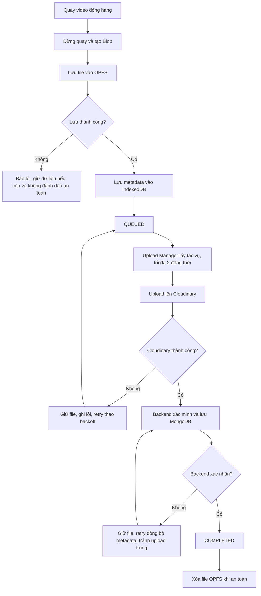

# Background Video Upload Queue — Hệ thống quay video đóng hàng

## 1. Mục tiêu

Xây dựng cơ chế quay video đóng hàng liên tục và upload lên Cloudinary mà không phải đợi video trước hoàn tất. Video được lưu an toàn trên thiết bị trước khi đưa vào hàng đợi; upload chạy độc lập với màn hình quay.

**Phạm vi giả định:** Frontend web React, backend Node.js, MongoDB Atlas và Cloudinary. Khi tích hợp, cần kiểm tra stack và code hiện tại, không tự ý thay đổi nghiệp vụ.

### Yêu cầu

- Quay xong video #1 có thể quay video #2 ngay sau khi file #1 được lưu cục bộ an toàn.
- Lưu file video tạm trong **OPFS**; lưu metadata và trạng thái queue trong **IndexedDB**.
- Tối đa **2 upload đồng thời** (cấu hình được); các video khác chờ.
- Mất mạng, lỗi upload hoặc refresh trang: giữ file đã lưu và phục hồi queue khi mở lại.
- Mỗi video gắn đúng `orderId` và có `recordingId` duy nhất.
- Chỉ xóa file local sau khi backend xác nhận đã lưu kết quả upload.
- Có UI hiển thị tiến độ, lỗi, số lượng đang chờ và dung lượng sử dụng.

## 2. Luồng hoạt động



**Ví dụ:** Nhân viên quay xong đơn #001, file được lưu vào OPFS và bắt đầu upload. Trong lúc đó nhân viên quay đơn #002. Khi #002 kết thúc, file được lưu và xếp vào queue. Nếu đã có 2 upload đang chạy, #002 chờ tới lượt.

## 3. Kiến trúc module

| Module | Trách nhiệm |
|---|---|
| `RecordingService` | Quản lý camera/MediaRecorder, tạo `recordingId`, hoàn tất bản ghi |
| `VideoStorageService` | Ghi/đọc/xóa video OPFS, kiểm tra quota |
| `UploadQueueDB` | IndexedDB: metadata, trạng thái, retry, file path |
| `UploadManager` | Điều phối queue, concurrency, pause/resume, phục hồi |
| `CloudinaryUploadService` | Upload có xác thực, báo progress, hỗ trợ file lớn |
| `RetryManager` | Phân loại lỗi, backoff, retry khi có mạng |
| `PackingVideoAPI` | Xác thực, cấp quyền upload, xác minh kết quả, lưu MongoDB |
| `UploadQueueUI` | Dashboard tiến độ, số lượng chờ/lỗi, thao tác retry |

Upload Manager nên ở cấp ứng dụng, không bị unmount khi chuyển màn hình quay đơn hàng.

## 4. Thiết kế dữ liệu

### 4.1. IndexedDB (trên thiết bị)

```json
{
  "recordingId": "rec-uuid-001",
  "orderId": "ORDER-001",
  "fileName": "ORDER-001-rec-uuid-001.webm",
  "filePath": "recordings/rec-uuid-001.webm",
  "fileSize": 104857600,
  "mimeType": "video/webm",
  "status": "QUEUED",
  "progress": 0,
  "retryCount": 0,
  "nextRetryAt": null,
  "createdAt": "2026-10-21T08:00:00Z",
  "lastError": null,
  "cloudinaryPublicId": null
}
```

Nên có các trạng thái: `RECORDING`, `SAVED_LOCAL`, `QUEUED`, `UPLOADING`, `SYNC_PENDING`, `COMPLETED`, `FAILED`. `SYNC_PENDING` dùng khi Cloudinary đã nhận file nhưng backend chưa xác nhận metadata.

### 4.2. MongoDB Atlas (trên server)

Collection `packing_videos`:

```json
{
  "recordingId": "rec-uuid-001",
  "orderId": "ORDER-001",
  "cloudinaryPublicId": "packing/ORDER-001/rec-uuid-001",
  "cloudinaryUrl": "https://res.cloudinary.com/...",
  "status": "COMPLETED",
  "fileSize": 104857600,
  "uploadedAt": "2026-10-21T08:05:00Z"
}
```

Tạo **unique index** cho `recordingId`. Endpoint xác nhận upload phải **idempotent**: gọi lại không tạo video trùng.

## 5. Quy tắc xử lý

### 5.1. Kết thúc quay

1. Nhận Blob từ MediaRecorder.
2. Kiểm tra quota còn lại và ghi file vào OPFS.
3. Xác nhận ghi hoàn tất, lưu metadata vào IndexedDB.
4. Đưa video vào queue và giải phóng tài nguyên quay để tiếp tục đơn mới.
5. Nếu ghi file hoặc metadata lỗi, thông báo rõ; không giả định video đã được lưu an toàn.

### 5.2. Upload

1. Upload Manager lấy video `QUEUED` hoặc `FAILED` đủ điều kiện retry.
2. Chỉ cho tối đa 2 upload chạy đồng thời.
3. Backend cấp chữ ký/thông tin upload phù hợp; **không bao giờ đưa Cloudinary API Secret lên frontend**.
4. Với video lớn, dùng cơ chế chunked upload tương thích Cloudinary. Không mặc định rằng mọi upload bị ngắt đều có thể resume từ byte trước đó.
5. Ghi tiến độ upload vào trạng thái hiển thị; chỉ ghi metadata cần thiết vào IndexedDB để tránh ghi quá thường xuyên.

### 5.3. Upload thành công

1. Nhận kết quả từ Cloudinary.
2. Backend xác minh kết quả và quyền truy cập đơn hàng.
3. Lưu `public_id`, URL, dung lượng và trạng thái vào MongoDB.
4. Backend trả xác nhận thành công.
5. Đánh dấu `COMPLETED` và xóa file OPFS; nếu xóa thất bại, dọn sau.

Nếu Cloudinary thành công nhưng lưu MongoDB lỗi, chuyển `SYNC_PENDING`, giữ định danh Cloudinary và retry bước đồng bộ metadata trước, tránh upload lại không cần thiết.

### 5.4. Mất mạng, refresh, nhiều tab

- Khi offline: dừng gửi request, giữ file và queue, retry khi có mạng.
- Khi refresh/mở lại: đọc IndexedDB, kiểm tra file OPFS, đối chiếu tác vụ chưa rõ trạng thái với backend và khôi phục.
- Khi đóng trình duyệt: **không đảm bảo upload tiếp tục chạy**; upload tiếp khi mở lại web.
- Dùng Web Locks API hoặc cơ chế leader election/lease phù hợp để tránh hai tab upload cùng một tác vụ.
- Retry với exponential backoff (ví dụ 5s, 15s, 30s, 60s), giới hạn số lần và phân loại lỗi không nên retry.

### 5.5. Dung lượng và 100 video chờ

Ví dụ 100 video × 100 MB = **10 GB** lưu cục bộ. OPFS và IndexedDB phụ thuộc quota của trình duyệt và dung lượng thiết bị, không đảm bảo luôn có 10 GB. Dùng `navigator.storage.estimate()` để ước lượng quota và `navigator.storage.persist()` để xin lưu trữ bền vững khi hỗ trợ. Cảnh báo khi sắp đầy và ngừng nhận bản quay mới nếu không thể lưu an toàn. Không xóa video chưa được backend xác nhận.

## 6. Giao diện Upload Queue

Hiển thị:

- Tổng video, đang upload, đang chờ, thất bại, đã hoàn tất.
- `orderId`, tên video, dung lượng, tiến độ, thời gian và lỗi gần nhất.
- Tổng dung lượng đang lưu cục bộ và trạng thái mạng.
- Nút retry thủ công, tạm dừng/tiếp tục queue.
- Cảnh báo dung lượng gần đầy và video chưa đồng bộ.

Pause queue nghĩa là không bắt đầu tác vụ mới; nếu cần dừng request đang chạy phải hỗ trợ hủy an toàn và xác định rõ khả năng resume.

## 7. Kiểm thử chấp nhận

1. Quay #002 trong lúc #001 đang upload.
2. Queue có 100 video, vẫn chỉ upload tối đa 2 đồng thời.
3. Mất mạng giữa upload, file local còn nguyên.
4. Refresh khi đang upload và khôi phục queue.
5. Đóng/mở lại trình duyệt, video đã lưu còn nếu storage không bị xóa.
6. Cloudinary thành công nhưng MongoDB lỗi: không tạo bản ghi hoặc upload trùng.
7. Thiết bị hết quota: cảnh báo, không báo lưu thành công sai.
8. Hai tab mở cùng lúc: không upload trùng.
9. Lỗi xác thực và lỗi mạng được xử lý khác nhau.
10. File local chỉ bị xóa sau khi backend xác nhận hoàn tất.

## 8. Prompt triển khai cho Codex

> Hãy phân tích codebase hiện tại trước khi sửa. Xây dựng Background Video Upload Queue cho tính năng quay video đóng hàng theo đặc tả trong file này. Tận dụng các service, API, model và component hiện có; không thay đổi nghiệp vụ hiện tại không cần thiết. Frontend web lưu file trong OPFS, lưu metadata trong IndexedDB, quản lý upload bằng một UploadManager cấp ứng dụng với concurrency mặc định 2. Backend xác thực, cấp quyền upload Cloudinary, xác minh kết quả và lưu MongoDB theo `recordingId` duy nhất. Hỗ trợ retry, khôi phục sau refresh, chống upload trùng nhiều tab, trạng thái `SYNC_PENDING`, kiểm tra quota và UI theo dõi queue. Viết kiểm thử cho các trường hợp trong mục 7. Trước khi triển khai hãy báo các module/file dự kiến thêm hoặc sửa; sau triển khai liệt kê file thay đổi, API mới, cách vận hành và kết quả kiểm thử.

## 9. Giới hạn và hướng nâng cấp

Giải pháp OPFS + IndexedDB + Upload Queue phù hợp với web, nhưng **không đảm bảo upload khi đã đóng trình duyệt** và không đảm bảo dữ liệu tồn tại nếu người dùng xóa dữ liệu website hoặc hệ thống dọn storage. Nếu kho cần ghi hình cường độ cao và upload ngay cả khi đóng web, nên phát triển **Desktop Agent** hoặc ứng dụng desktop có bộ lưu trữ file và upload worker riêng.

## 10. Trạng thái triển khai

- File video sau khi dừng được ghi vào OPFS, metadata vào IndexedDB; queue cũ chứa Blob được chuyển sang OPFS khi mở lại web.
- Upload Manager chạy ở cấp ứng dụng khi đã đăng nhập, mặc định 2 tác vụ đồng thời, có Web Locks và lease dự phòng cho trình duyệt thiếu Web Locks. Queue tự phục hồi sau refresh; nút tạm dừng chỉ ngăn bắt đầu tác vụ mới.
- Backend dùng Cloudinary `upload_chunked_stream`, định danh `packing/{sessionId}/{recordingId}` và collection `packing_videos` với unique index trên `recordingId`. API đồng bộ xác minh lại asset trên Cloudinary khi phản hồi upload bị mất hoặc MongoDB lỗi.
- UI hiển thị queue, trạng thái mạng, tiến độ upload, lỗi, dung lượng, retry và tạm dừng/tiếp tục.
- Tiến độ phần trăm đo chặng trình duyệt → backend; sau 99% backend còn cần chờ Cloudinary và MongoDB xác nhận. API Secret chỉ ở backend.
- Khi mạng ngắt giữa lượt gửi, lần thử sau kiểm tra Cloudinary theo `recordingId`; nếu asset chưa hoàn tất thì gửi lại từ đầu, không tiếp tục từ byte trước đó.
- Giới hạn ứng dụng hiện tại là 512 MB/video và 30 phút/video. Việc quay vẫn tích lũy các chunk trong bộ nhớ tới khi dừng; nếu tab bị đóng đột ngột trước lúc lưu OPFS, đoạn đang quay có thể mất. Cloudinary và trình duyệt có thể áp giới hạn riêng.
