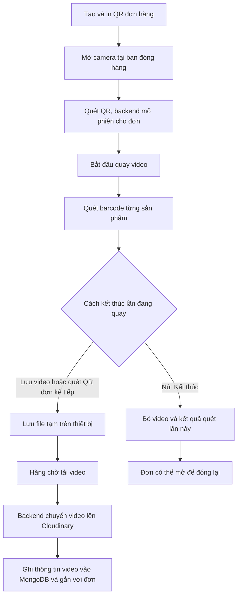

# Giải thích chức năng đóng hàng theo luồng hoạt động

Tài liệu này mô tả **mã nguồn đang chạy trong repository**, từ lúc tạo QR cho đơn đến lúc lưu hoặc bỏ video đóng hàng. Các đường dẫn bên dưới là liên kết tương đối: có thể mở trực tiếp khi xem tài liệu trong repository.

> **Theo mã hiện tại:** Video bắt đầu quay **ngay khi QR mở đơn thành công** và người dùng vẫn quét barcode trong lúc quay.

## 1. Toàn cảnh

- **QR đơn hàng** xác định đơn cần đóng. QR chứa token dạng `PACK:v1:...`, không phải toàn bộ thông tin khách hàng.
- **Barcode sản phẩm** xác định từng món vật lý và được backend đối chiếu với đơn.
- **Video** ghi quá trình thao tác. File video tạm nằm ở thiết bị; video được lưu lâu hơn trên Cloudinary sau khi tải thành công.
- **MongoDB** lưu phiên đóng hàng, kết quả quét, món đã gắn vào đơn và thông tin video. Cloudinary lưu nội dung file video.

## 2. Các file frontend và trách nhiệm

| File | Vai trò |
|---|---|
| [OrderQrPage.jsx](../ARAWMS_FE/src/pages/OrderQrPage.jsx) | Màn hình chọn/tìm đơn, lấy hoặc cấp QR, tạo ảnh QR để hiển thị và in. |
| [orderQrService.js](../ARAWMS_FE/src/services/orderQrService.js) | Các lời gọi API dành riêng cho quản lý QR đơn hàng. |
| [WarehousePackingPage.jsx](../ARAWMS_FE/src/pages/WarehousePackingPage.jsx) | Giao diện bàn đóng hàng: camera, đơn hiện tại, barcode, quay video, hàng chờ và các nút kết thúc. |
| [packingSessionService.js](../ARAWMS_FE/src/services/packingSessionService.js) | Các lời gọi API của phiên đóng hàng: mở phiên, gia hạn, quét barcode, bỏ lần đóng, tải và xem video. |
| [localPackingVideoQueue.js](../ARAWMS_FE/src/services/localPackingVideoQueue.js) | Ghi/đọc/xóa file video tạm trong OPFS; ghi metadata và trạng thái hàng chờ trong IndexedDB. |
| [packingVideoUploadManager.js](../ARAWMS_FE/src/services/packingVideoUploadManager.js) | Điều phối tải video, theo dõi tiến độ, xử lý mất mạng, thử lại và đồng bộ kết quả. |
| [packingQueuePolicy.js](../ARAWMS_FE/src/services/packingQueuePolicy.js) | Chọn tác vụ đủ điều kiện chạy và tính thời điểm thử lại sau lỗi. |
| [PackingUploadRunner.jsx](../ARAWMS_FE/src/components/PackingUploadRunner.jsx) | Khởi động bộ tải video ở cấp ứng dụng khi người dùng đã đăng nhập. |
| [api.js](../ARAWMS_FE/src/services/api.js) | Cấu hình Axios chung: địa chỉ API, Bearer token và chuyển lỗi HTTP thành lỗi dùng được trên giao diện. |

### Các hàm chính trên màn hình đóng hàng

Trong [WarehousePackingPage.jsx](../ARAWMS_FE/src/pages/WarehousePackingPage.jsx):

| Hàm | Làm gì? |
|---|---|
| `startCamera` | Mở camera và chạy bộ đọc QR/Code 128 của ZXing. |
| `openPackingOrderFromQr` | Xử lý QR, mở phiên trên backend, hiển thị đơn và bắt đầu quay. |
| `startRecording` | Tạo `MediaRecorder`, thu các phần video và cấp `recordingId` duy nhất. |
| `scanBarcode` | Gửi barcode lên backend, hiển thị kết quả nhận hoặc lý do từ chối. |
| `removeScannedBarcode` | Gỡ một barcode đã quét để trả lại chỗ và quét mã khác thay vào. |
| `stopRecordingAndQueueVideo` | Dừng quay, chờ dữ liệu cuối, ghi video tạm và đưa vào hàng chờ tải. |
| `saveVideoAndReleaseOrder` | Xử lý nút **Lưu video và hoàn tất đơn**: xếp video vào hàng chờ rồi nhả phiên ở bàn. |
| `discardCurrentPackingAttempt` | Xử lý nút **Kết thúc**: bỏ video đang quay và yêu cầu backend xóa tiến độ quét lần này. |
| `viewSavedVideo` | Lấy video đã lưu qua API để xem lại theo quyền truy cập. |

`useState` giữ dữ liệu để vẽ màn hình như đơn, phiên, lỗi và trạng thái quay. `useRef` giữ các đối tượng thay đổi liên tục như camera, recorder và phiên hiện hành. `useEffect` đăng ký hàng chờ, gia hạn phiên định kỳ và dọn tài nguyên khi rời màn hình.

## 3. Các file backend và dữ liệu

| File | Vai trò |
|---|---|
| [orderQrManagement.routes.js](../ARAWMS_BE/src/modules/order-fulfillment/order-qr-management/orderQrManagement.routes.js) | Các endpoint quản lý QR. |
| [orderQrManagement.service.js](../ARAWMS_BE/src/modules/order-fulfillment/order-qr-management/orderQrManagement.service.js) | Tạo token ngẫu nhiên, tra QR ra đơn và tạo dữ liệu đơn trả về frontend. |
| [packingVerification.routes.js](../ARAWMS_BE/src/modules/order-fulfillment/packing-verification/packingVerification.routes.js) | Các endpoint `/packing`: mở phiên, quét, kết thúc, tải video và xem video. |
| [packingVerification.controller.js](../ARAWMS_BE/src/modules/order-fulfillment/packing-verification/packingVerification.controller.js) | Nhận request, kiểm tra quyền đối với đơn, gọi service và trả response. |
| [packingVerification.service.js](../ARAWMS_BE/src/modules/order-fulfillment/packing-verification/packingVerification.service.js) | Nghiệp vụ phiên: giữ đơn tại một bàn, gia hạn, nhận/từ chối barcode và bỏ lần đóng. |
| [packingVideo.service.js](../ARAWMS_BE/src/modules/order-fulfillment/packing-verification/packingVideo.service.js) | Nhận video, tải lên Cloudinary, đồng bộ MongoDB và phục vụ xem lại. |
| [packingIndexes.js](../ARAWMS_BE/src/modules/order-fulfillment/packing-verification/packingIndexes.js) | Bảo đảm các chỉ mục duy nhất cần thiết đã được tạo trước thao tác ghi. |

Các model liên quan:

| Model | Dữ liệu lưu |
|---|---|
| [PackingSession.js](../ARAWMS_BE/src/models/PackingSession.js) | Đơn đang đóng, bàn và nhân viên thao tác, thời hạn phiên, danh sách hàng cần quét/đã quét, video đã gắn. |
| [PackingScanEvent.js](../ARAWMS_BE/src/models/PackingScanEvent.js) | Mỗi request quét barcode cùng kết quả `ACCEPTED`/`REJECTED`; `clientEventId` giúp nhận request gửi lặp. |
| [ProductUnitAllocation.js](../ARAWMS_BE/src/models/ProductUnitAllocation.js) | Barcode vật lý đã được gắn vào đơn/phiên nào, giúp chặn gắn sang đơn khác. |
| [PackingVideo.js](../ARAWMS_BE/src/models/PackingVideo.js) | `recordingId`, định danh Cloudinary, URL, dung lượng, thời lượng và trạng thái đồng bộ. |
| [OrderQrToken.js](../ARAWMS_BE/src/models/OrderQrToken.js) và [DemoOrderQrToken.js](../ARAWMS_BE/src/models/DemoOrderQrToken.js) | Ánh xạ token QR còn hiệu lực tới đơn thật hoặc đơn mẫu. |

`packingVerification.validation.js` hiện chỉ là khung hàm validation và **chưa được gắn vào các route**; phần kiểm tra đầu vào thực tế nằm trong controller/service.

## 4. Thư viện và API trình duyệt hỗ trợ gì?

### Thư viện cài trong dự án

Phiên bản khai báo nằm ở [package.json frontend](../ARAWMS_FE/package.json) và [package.json backend](../ARAWMS_BE/package.json). Dấu `^` cho phép npm chọn phiên bản tương thích theo quy tắc semver; xem `package-lock.json` nếu cần biết chính xác bản đã cài.

| Thư viện | Được dùng vào việc gì? |
|---|---|
| **React** | Vẽ giao diện và quản lý trạng thái camera, đơn, hàng chờ. [Tài liệu hooks](https://react.dev/reference/react/useRef). |
| **React Router** | Đưa người dùng đến trang QR đơn `/orders/qr` và trang bàn đóng hàng `/packing/qr`. |
| **`qrcode`** | **Tạo ảnh QR** từ chuỗi token bằng `QRCode.toDataURL(...)`; dùng trên màn hình cấp/in QR. [Tài liệu qrcode](https://github.com/soldair/node-qrcode/blob/master/README.md). |
| **`@zxing/browser`** | **Đọc QR và barcode** từ camera bằng `decodeFromConstraints`. [Tài liệu ZXing](https://github.com/zxing-js/browser). |
| **Axios** | Gửi request từ frontend đến backend, gắn token đăng nhập và báo tiến độ gửi file. |
| **Express** | Định tuyến request qua middleware xác thực rồi đến controller. [Tài liệu Express](https://expressjs.com/en/guide/using-middleware/). |
| **Mongoose** | Định nghĩa model MongoDB, chỉ mục và transaction để cập nhật nhiều collection cùng một lượt. [Tài liệu transaction](https://mongoosejs.com/docs/8.x/docs/transactions.html). |
| **Cloudinary SDK** | Backend gửi video lên Cloudinary bằng `upload_chunked_stream` và tra lại tài nguyên khi cần đồng bộ. API Secret chỉ ở backend. [Tài liệu Cloudinary](https://cloudinary.com/documentation/node_image_and_video_upload). |

### API có sẵn của trình duyệt — không phải gói npm

| API | Vai trò trong mã hiện tại |
|---|---|
| **Camera / `getUserMedia`** | Cấp luồng hình cho preview, ZXing và MediaRecorder. Camera thường cần HTTPS hoặc `localhost` và quyền từ người dùng. [Tài liệu MDN](https://developer.mozilla.org/en-US/docs/Web/API/MediaDevices/getUserMedia). |
| **`MediaRecorder`** | Quay từ luồng camera, phát các phần dữ liệu qua `dataavailable`, tạo `Blob` khi dừng. Mã gọi `start(2000)` và ghép các phần khi `onstop` chạy. [Tài liệu MDN](https://developer.mozilla.org/en-US/docs/Web/API/MediaRecorder). |
| **OPFS** | Vùng file riêng của website trên thiết bị; file video tạm được ghi vào thư mục `packing-recordings`. [Tài liệu MDN](https://developer.mozilla.org/en-US/docs/Web/API/File_System_API/Origin_private_file_system). |
| **IndexedDB** | Lưu metadata hàng chờ như `recordingId`, đường dẫn file, trạng thái, lỗi và lần thử lại. [Tài liệu MDN](https://developer.mozilla.org/en-US/docs/Web/API/IndexedDB_API/Using_IndexedDB). |
| **Web Locks** | Giúp các tab cùng website không đồng thời xử lý một hàng chờ. Khi API này không có, mã dùng lease ngắn trong `localStorage`. [Tài liệu MDN](https://developer.mozilla.org/en-US/docs/Web/API/Web_Locks_API). |
| **Storage API** | `estimate()` ước lượng dung lượng còn lại; `persist()` yêu cầu trình duyệt ưu tiên giữ dữ liệu website khi được hỗ trợ. |

Lưu ý: ZXing **đọc** mã, còn `qrcode` **tạo** mã. OPFS giữ **nội dung file video**, còn IndexedDB giữ **thông tin quản lý file và tác vụ tải**.

## 5. Flow chi tiết từ đầu đến cuối

### Bước 1 — Cấp và in QR đơn hàng

1. [OrderQrPage.jsx](../ARAWMS_FE/src/pages/OrderQrPage.jsx) gọi [orderQrService.js](../ARAWMS_FE/src/services/orderQrService.js).
2. Backend tạo hoặc lấy token QR đang có của đơn. Nội dung QR có prefix `PACK:v1:`.
3. `qrcode` chuyển chuỗi này thành ảnh QR để hiển thị/in. QR là mã tra cứu; backend vẫn kiểm tra người dùng đã đăng nhập và có quyền xử lý đơn.

### Bước 2 — Mở bàn, quét QR và bắt đầu quay

1. Nhân viên mở camera trên [WarehousePackingPage.jsx](../ARAWMS_FE/src/pages/WarehousePackingPage.jsx). ZXing đọc QR và Code 128 từ camera.
2. Khi nhận QR đơn, frontend gọi `packingSessionService.openSession`. Backend xác thực, kiểm tra quyền, trạng thái đơn và quyền giữ phiên tại bàn.
3. [PackingSession.js](../ARAWMS_BE/src/models/PackingSession.js) lưu `stationId`, `leaseUntil`, `leaseVersion`, snapshot hàng cần đóng và tiến độ quét. Frontend gọi API gia hạn phiên khoảng mỗi 60 giây; thời hạn backend đặt là 120 giây.
4. Khi mở phiên thành công và chưa có video đã lưu hoặc video đang chờ tải, `startRecording` bắt đầu quay ngay. `recordingId` riêng được tạo cho bản quay.

Nếu quét QR của **chính đơn đang quay**, frontend tiếp tục quay. Nếu quét QR **đơn khác**, frontend kiểm tra QR đó trước, rồi dừng/lưu video đơn hiện tại và mở đơn mới.

### Bước 3 — Quét barcode sản phẩm

1. Mỗi barcode được gửi cùng `stationId`, `leaseVersion` và `clientEventId` tới `/packing/sessions/:id/scan`.
2. `evaluatePackingBarcodeScan` kiểm tra mã có tồn tại, còn khả dụng, đúng SKU/biến thể trong đơn và chưa vượt số lượng hay chưa.
3. Backend kiểm tra [ProductUnitAllocation.js](../ARAWMS_BE/src/models/ProductUnitAllocation.js) để chặn barcode đã gắn vào đơn khác.
4. Barcode hợp lệ được thêm vào `scannedUnits`; kết quả request được lưu trong [PackingScanEvent.js](../ARAWMS_BE/src/models/PackingScanEvent.js). Khi quét đủ, trạng thái phiên thành `READY_TO_RECORD`.

Nếu quét nhầm một món, nhân viên chọn **Gỡ mã** ngay cạnh barcode đó. Backend chỉ cho gỡ khi phiên còn thuộc bàn hiện tại và video chưa được lưu. Một transaction sẽ xóa liên kết barcode khỏi đơn, đánh dấu sự kiện quét cũ đã bị đảo ngược, giảm số lượng đã quét và đưa phiên về `SCANNING`. Các barcode khác vẫn giữ nguyên. Sau đó có thể quét barcode khác vào chỗ vừa trả lại. Camera tạm bỏ qua chính mã vừa gỡ cho đến khi thấy mã khác, tránh tự gắn lại khi tem cũ còn trước ống kính.

**Tên trạng thái `READY_TO_RECORD` dễ gây hiểu nhầm trong luồng hiện tại:** nó báo đã quét đủ sản phẩm, nhưng video đã bắt đầu từ bước 2.

### Bước 4A — Chọn “Lưu video và hoàn tất đơn”

1. Frontend gọi `MediaRecorder.stop()` và chờ `onstop` để nhận cả phần dữ liệu cuối.
2. [localPackingVideoQueue.js](../ARAWMS_FE/src/services/localPackingVideoQueue.js) kiểm tra dung lượng, ghi `Blob` vào OPFS rồi ghi metadata `QUEUED` vào IndexedDB.
3. Frontend nhả phiên tại bàn. Người dùng có thể quét QR đơn tiếp theo trong khi video cũ đang được tải.
4. [packingVideoUploadManager.js](../ARAWMS_FE/src/services/packingVideoUploadManager.js) chọn tác vụ; mặc định tối đa 2 video được xử lý trong một lượt. Bộ quản lý thử đồng bộ video trước để tránh tải lại file mà Cloudinary có thể đã nhận.
5. Nếu Cloudinary chưa có file, frontend đọc file OPFS, gửi qua backend; backend dùng `upload_chunked_stream` để đưa lên Cloudinary.
6. Backend lưu metadata video trong MongoDB và gắn URL vào đơn. Khi trả `COMPLETED`, frontend đánh dấu tác vụ hoàn tất và xóa file tạm OPFS.

Các trạng thái dễ gặp: `QUEUED` (chờ), `UPLOADING` (đang gửi), `SYNC_PENDING` (Cloudinary có thể đã nhận nhưng MongoDB chưa xác nhận), `FAILED` (lỗi) và `COMPLETED` (đã xác nhận). `packingQueuePolicy.js` đặt lịch thử lại 5, 15, 30 rồi 60 giây cho lỗi tạm thời; sau đó tiếp tục thử cách nhau 60 giây khi website đang mở và có kết nối. Lỗi cần can thiệp như sai cấu hình sẽ ngừng tự thử và được báo trên màn hình. Tiến độ 99% chỉ nói rằng phần gửi từ trình duyệt đến backend gần xong; còn phải chờ Cloudinary và MongoDB xác nhận.

### Bước 4B — Chọn “Kết thúc” để bỏ lần đang quay

1. Frontend kiểm tra không có video chưa hoàn tất của phiên trong hàng chờ, dừng recorder và **không ghi bản quay này vào OPFS/IndexedDB**.
2. Frontend gọi `/packing/sessions/:id/cancel`.
3. Backend kiểm tra phiên vẫn thuộc bàn hiện tại và chưa có video đã lưu. Trong một transaction, backend xóa allocation barcode và sự kiện quét của phiên, làm rỗng `scannedUnits`, đưa trạng thái về `SCANNING` và nhả quyền giữ phiên.
4. Giao diện đóng đơn đang xem. Quét lại QR sẽ mở đơn để làm lại từ đầu.

Nếu video đã được lưu trên backend, thao tác bỏ lần đóng bị từ chối. **Đóng lại hiện dùng lại bản ghi `PackingSession` đã reset**; mã chưa tạo các bản lịch sử attempt riêng như A1/A2.

## 6. Những điểm cần hiểu đúng khi vận hành

- Nút **Lưu video và hoàn tất đơn** đưa video vào hàng chờ cục bộ trước. Chỉ khi backend xác nhận xong mới chắc chắn video đã gắn vào đơn trên MongoDB/Cloudinary.
- Trong mã hiện tại, `VIDEO_SAVED` dựa vào video đã gắn. Chưa có bước chốt `final` độc lập bắt buộc **đủ barcode và video** trước khi xác nhận một đơn đóng hàng hoàn chỉnh.
- Các phần video đang quay được giữ trong bộ nhớ đến lúc dừng và ghi OPFS. Nếu tab đóng đột ngột trước bước ghi này, đoạn đang quay có thể mất.
- Video đã ghi vào OPFS/IndexedDB có thể được xử lý tiếp khi mở lại website. **Đóng trình duyệt thì không bảo đảm upload vẫn chạy.** Xóa dữ liệu website cũng có thể xóa dữ liệu tạm trong trình duyệt.
- Khi mất mạng lúc đang quay, camera và bản quay có thể tiếp tục trên thiết bị, nhưng quét barcode/QR mới cần backend nên sẽ không được xác nhận cho đến khi có mạng. Nếu dừng quay, video được lưu tạm trên thiết bị và đợi mạng để tải lên; thao tác nhả phiên trên backend có thể báo lỗi, và phiên có thể cần mở lại sau khi kết nối phục hồi.
- Phiên tại bàn được gia hạn mỗi 60 giây, còn backend cấp thời hạn 120 giây. Lỗi gia hạn hiện khiến giao diện đóng phiên đang mở và dừng camera. Hệ thống chưa tự khôi phục toàn bộ phiên quét sau khi mất mạng; nhân viên cần mở lại đơn và đối chiếu trạng thái barcode.
- Màn hình nhân viên chỉ hiển thị trạng thái video; không có nút tạm dừng queue, thử lại thủ công hoặc xóa video tạm. Lỗi tạm thời được tự thử lại khi website đang mở và có mạng. Nếu hiện “Cần hỗ trợ”, nhân viên báo quản lý và giữ dữ liệu website trên thiết bị.

## 7. Nơi kiểm tra hành vi

- [packingVerification.test.js](../ARAWMS_BE/src/modules/order-fulfillment/packing-verification/packingVerification.test.js): quyết định nhận/từ chối barcode và quyền đóng đơn.
- [packingVideo.test.js](../ARAWMS_BE/src/modules/order-fulfillment/packing-verification/packingVideo.test.js): đồng bộ và liên kết video với đơn.
- [packingQueuePolicy.test.js](../ARAWMS_FE/src/services/packingQueuePolicy.test.js): chọn tác vụ và lịch thử lại.

Các test này kiểm tra một số quy tắc quan trọng, nhưng không thay cho việc thử toàn bộ luồng với camera, trình duyệt, MongoDB và Cloudinary thật.
