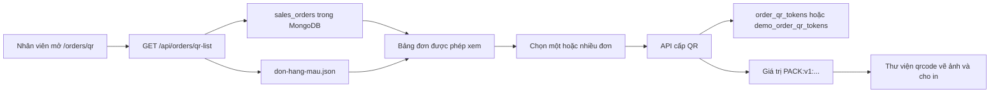

# Giải thích màn hình tạo QR đơn hàng

Tài liệu này mô tả chức năng hiện có tại `/orders/qr`: hiển thị danh sách đơn, xem từng đơn, chốt đơn, cấp QR riêng lẻ hoặc hàng loạt và in tem đơn hàng có QR. Nội dung bám theo code trong `ARAWMS_FE/src/pages/OrderQrPage.jsx` và các API tương ứng ở `ARAWMS_BE`.

## 1. Vì sao màn hình có thể lấy danh sách và tạo QR?

Frontend gọi API của backend. Backend đọc đơn thật từ collection MongoDB `sales_orders` qua model `SalesOrder` và đọc 5 đơn mẫu từ file `don-hang-mau.json`. Backend kiểm tra tài khoản đăng nhập trước khi trả dữ liệu. Với đơn thật, `ADMIN` xem được toàn bộ; `SALES` chỉ xem các đơn có `sellerId` là chính mình. Đơn mẫu được hiển thị cho mọi tài khoản đã đăng nhập. Vì vậy, chữ **“toàn bộ đơn”** trên màn hình có nghĩa là toàn bộ đơn mà tài khoản này được quyền cấp QR, cộng với các đơn mẫu.

Danh sách chỉ cần thông tin tóm tắt: ID, mã đơn, người nhận, trạng thái, tổng số món, đã có QR hay chưa và có được cấp QR ở trạng thái hiện tại hay không. Khi bấm **Xem đơn**, frontend mới gọi API lấy chi tiết sản phẩm, size, màu và thông tin giao hàng của đơn đó.

QR không mã hóa toàn bộ thông tin khách hàng. Backend tạo token ngẫu nhiên 256 bit và trả giá trị dạng `PACK:v1:<token>`. Quan hệ giữa token và đơn được lưu vào `order_qr_tokens` (đơn thật) hoặc `demo_order_qr_tokens` (đơn mẫu). Frontend dùng thư viện `qrcode` để vẽ giá trị đó thành ảnh QR. Khi kho quét, backend tra token và kiểm tra quyền rồi mới trả chi tiết đơn.

## 2. Vị trí các phần trên màn hình

Từ thanh điều hướng, vào **Chốt đơn / QR** để mở `/orders/qr`. Từ trên xuống dưới màn hình có:

1. Tiêu đề **Chốt đơn và cấp QR**.
2. Khung **Danh sách đơn hàng**: ô tìm kiếm; nút **Tải lại danh sách**; nút **Tạo / lấy QR hàng loạt**; bảng có ô chọn ở đầu mỗi dòng và nút **Xem đơn** ở cuối dòng.
3. Khung **Đơn [mã đơn]**: xuất hiện sau khi bấm **Xem đơn**, hiển thị chi tiết người nhận và các dòng sản phẩm.
4. Khung thao tác của đơn đang xem: nút **Chốt đơn và tạo QR**, hoặc **Tạo / lấy QR đơn này** và **Thu hồi và cấp QR mới**, tùy trạng thái.
5. Khung **Mã QR đã tạo**: chỉ xuất hiện khi ít nhất một QR đã được lấy/tạo trong lần mở trang hiện tại; có nút in và nút xóa ảnh khỏi màn hình.

## 3. Bấm từng nút thì điều gì xảy ra?

| Thành phần, vị trí | Điều kiện hiển thị / sử dụng | Luồng chạy | Kết quả |
|---|---|---|---|
| Ô **Tìm đơn hàng**, phía trên bảng | Luôn có sau khi trang tải | `setSearch` cập nhật từ khóa; `filteredOrders` lọc danh sách đã tải theo mã đơn, ID, tên người nhận hoặc trạng thái. | Bảng đổi ngay trên trình duyệt, không gửi yêu cầu tìm kiếm mới lên server. |
| **Tải lại danh sách**, bên phải ô tìm | Không có thao tác đang chạy | `refreshOrders()` gọi `GET /api/orders/qr-list`. | Cập nhật danh sách và cột **QR** sau khi có thay đổi. |
| Ô chọn ở đầu dòng | Chỉ chọn được đơn có `canIssueQr = true` | Thêm/bỏ ID trong `selectedIds`. | Chuẩn bị tập đơn cho thao tác hàng loạt; bản thân việc chọn chưa ghi database. |
| Ô chọn ở đầu cột | Có ít nhất một đơn hợp lệ trong kết quả đang hiển thị | Chọn hoặc bỏ chọn **tất cả đơn hợp lệ đang hiển thị sau khi lọc**. | Các đơn `PENDING` và đơn không đủ điều kiện vẫn không được chọn. Các lựa chọn ngoài bộ lọc hiện tại vẫn được giữ. |
| **Tạo / lấy QR hàng loạt (n)**, phía trên bảng | Đã chọn ít nhất một đơn | `issueSelected()` chia ID thành các nhóm tối đa 100, gọi `POST /api/orders/packing-qr/bulk` cho từng nhóm, nhận kết quả từng đơn rồi gọi `addQrCard()` để vẽ QR. | Hiển thị các QR thành công ở cuối trang; thông báo số lượng thành công và các đơn lỗi. Những đơn thành công được bỏ khỏi danh sách đang chọn. |
| **Xem đơn**, cuối mỗi dòng | Không có thao tác đang chạy | `chooseOrder(id)` gọi `GET /api/orders/lookup?code=<id>`. | Hiển thị chi tiết đơn và các nút phù hợp bên dưới bảng. |
| **Chốt đơn và tạo QR**, trong khung thao tác đơn | Đơn thật đang `PENDING` | `confirm()` gọi `POST /api/orders/:id/confirm`. Backend chuyển trạng thái sang `CONFIRMED` có điều kiện và gọi `issueQr()`. | Trạng thái, danh sách và ảnh QR được cập nhật. Không dùng nút này cho đơn mẫu. |
| **Tạo / lấy QR đơn này**, trong khung thao tác đơn | Đơn mẫu hợp lệ hoặc đơn thật `CONFIRMED`/`PICKING` | `issueOne()` gọi `POST /api/orders/:id/packing-qr`, sau đó vẽ ảnh từ `qrValue`. | Nếu đơn chưa có QR, backend tạo token; nếu đã có, trả lại QR hiện hành. |
| **Thu hồi và cấp QR mới**, cạnh nút cấp QR đơn này | Cùng điều kiện với nút cấp QR đơn này | Hộp xác nhận hiện ra. Nếu đồng ý, `replace()` gọi `POST /api/orders/:id/packing-qr/replace`. | Token cũ bị thay thế; lần quét QR cũ không còn tìm được đơn. Ảnh QR mới thay ảnh của đơn đó trên màn hình. |
| **In tem các đơn đang hiển thị**, trong khung QR cuối trang | Đã có ít nhất một ảnh QR | Gọi `window.print()`; CSS `@media print` tạo một tem cho mỗi đơn, gồm QR, mã đơn, người nhận, sản phẩm, giá, thanh toán, vận chuyển và ghi chú có trong dữ liệu đơn. | Mở hộp thoại in của trình duyệt. In tem cho tất cả QR hiện có trong khung kết quả, kể cả QR tạo ở các thao tác trước trong cùng lần mở trang. |
| **Xóa khỏi màn hình**, cạnh nút in | Đã có ít nhất một ảnh QR | `setQrCards({})`. | Xóa ảnh khỏi giao diện hiện tại; **không thu hồi hoặc xóa QR đã lưu trên MongoDB**. Có thể bấm tạo/lấy lại. |

Các nút cấp QR đơn thật chỉ dùng được khi đơn đã chốt. Đơn `PENDING` vẫn nằm trong bảng để sale mở ra và chốt từng đơn. Chức năng hàng loạt hiện tại **không tự chốt hàng loạt**.

## 4. Các hàm chính và nhiệm vụ

### Frontend

| File / hàm | Nhiệm vụ |
|---|---|
| `ARAWMS_FE/src/pages/OrderQrPage.jsx` → `OrderQrPage()` | Giữ trạng thái danh sách `orders`, đơn đang xem `activeOrder`, lựa chọn `selectedIds`, ảnh QR `qrCards`, trạng thái tải và thông báo. `useEffect` gọi danh sách khi vào trang. |
| `filteredOrders` | Lọc tại trình duyệt theo ô tìm kiếm. |
| `refreshOrders()` | Lấy lại danh sách sau thao tác hoặc khi bấm **Tải lại danh sách**. |
| `chooseOrder(id)` | Lấy chi tiết một đơn để hiển thị. |
| `addQrCard(id, orderCode, qrValue)` | Dùng `QRCode.toDataURL()` biến giá trị QR thành ảnh PNG dạng data URL cho thẻ hiển thị/in. |
| `issueOne()` | Cấp hoặc lấy lại QR của đơn đang xem. |
| `issueSelected()` | Chia các ID đã chọn thành lô 100, gọi API cấp hàng loạt, tổng hợp thành công/lỗi và vẽ ảnh. |
| `confirm()` | Chốt một đơn `PENDING`, nhận QR được cấp ngay trong phản hồi. |
| `replace()` | Xác nhận thay QR, gọi API cấp token mới. |
| `ARAWMS_FE/src/services/orderQrService.js` → `list`, `lookup`, `issueBulk`, `confirm`, `issue`, `replace` | Đóng gói địa chỉ và phương thức HTTP cho các thao tác trên. |
| `ARAWMS_FE/src/services/api.js` | Gắn Bearer token đăng nhập vào HTTP request, xử lý phản hồi và lỗi API. |

### Backend

| File / hàm | Nhiệm vụ |
|---|---|
| `ARAWMS_BE/src/routes/orderQrRoutes.js` | Khai báo URL API, dùng middleware `protect` để yêu cầu JWT trước khi vào controller. |
| `ARAWMS_BE/src/controllers/orderQrController.js` → `listOrders()` | Gọi `listOrdersForQr(req.user)` và trả mảng `data.orders`. |
| `issueOrderQrBulk()` | Kiểm tra mảng 1–100 ID duy nhất; với từng ID, tìm đơn, kiểm tra quyền, gọi `issueQr()`, trả `data.results` có kết quả riêng từng đơn. |
| `lookupOrder()` | Tìm một đơn, kiểm tra quyền xem, trả chi tiết qua `publicOrderDetail()`. |
| `getOrderQr()` / `replaceOrderQr()` | Kiểm tra quyền cấp QR rồi cấp/lấy lại hoặc thay token. |
| `ARAWMS_BE/src/controllers/packingController.js` → `confirmOrder()` | Chỉ cho đơn thật `PENDING`; cập nhật trạng thái có điều kiện sang `CONFIRMED`, ghi lịch sử và cấp QR. |
| `ARAWMS_BE/src/services/orderQrService.js` → `listOrdersForQr()` | Đọc đơn thật theo quyền, đọc đơn mẫu, tra bản ghi QR để tính `hasQr` và `canIssueQr`, trả danh sách tóm tắt. |
| `findOrder()` / `publicOrderDetail()` | Tìm theo ID hoặc mã đơn; bổ sung dữ liệu SKU và tạo dữ liệu chi tiết trả cho giao diện. |
| `newQrValue()` / `issueQr()` | Sinh token ngẫu nhiên; dùng `findOneAndUpdate` với `upsert` và `$setOnInsert` để một đơn đã có QR tiếp tục nhận lại token cũ. |
| `replaceQr()` | Ghi token mới lên bản ghi QR của đơn; QR cũ không còn khớp khi tra. |
| `ARAWMS_BE/src/services/demoOrderService.js` → `listDemoOrders()` | Đọc 5 đơn mẫu từ file JSON; không thêm chúng vào `sales_orders`. |
| `ARAWMS_BE/src/services/orderAccessService.js` → `canIssueQr()` | Đơn thật: cho `ADMIN` hoặc `SALES` sở hữu đơn. Đơn mẫu: cho tài khoản đã đăng nhập. |

## 5. API và dữ liệu trả về

Mọi URL sau có tiền tố `/api` và cần đăng nhập. API trả `{ success, message, data }`; lỗi trả `{ success: false, message, errors: { code } }`.

| API | Được gọi khi | Dữ liệu chính |
|---|---|---|
| `GET /orders/qr-list` | Vào trang hoặc tải lại | `data.orders[]` gồm `id`, `orderCode`, `status`, `recipientName`, `itemCount`, `demoOnly`, `hasQr`, `canIssueQr`. |
| `GET /orders/lookup?code=<id>` | Bấm **Xem đơn** | `data.order` có thông tin giao hàng và từng dòng SKU/số lượng. |
| `POST /orders/:id/confirm` | Bấm **Chốt đơn và tạo QR** | `data.order`, `data.qrValue`. |
| `POST /orders/:id/packing-qr` | Bấm **Tạo / lấy QR đơn này** | `data.qrValue`, `data.order`. |
| `POST /orders/packing-qr/bulk` với `{ "orderIds": ["id1", "id2"] }` | Bấm **Tạo / lấy QR hàng loạt** | `data.results[]`: mỗi phần tử có `id`, `orderCode`, `qrValue` nếu thành công hoặc `error` nếu thất bại. |
| `POST /orders/:id/packing-qr/replace` | Bấm **Thu hồi và cấp QR mới** và xác nhận | `data.qrValue` mới. |

Ví dụ: chọn `DEMO-ORD-001` và `DEMO-ORD-002`, sau đó bấm **Tạo / lấy QR hàng loạt (2)**. Frontend gửi hai ID; backend tra hai đơn trong file mẫu, kiểm tra trạng thái và lưu/lấy hai token trong `demo_order_qr_tokens`. API trả hai `qrValue`. Frontend vẽ hai ảnh QR kèm mã đơn; bấm **In các QR đang hiển thị** sẽ in cả hai.

## 6. Những điểm cần nhớ khi sử dụng

- `hasQr = Đã cấp` chỉ nói rằng token đã tồn tại trên server. Muốn ảnh xuất hiện trong vùng in ở lần mở trang hiện tại, hãy bấm **Tạo / lấy QR đơn này** hoặc chọn đơn và bấm **Tạo / lấy QR hàng loạt**.
- QR của đơn mẫu và đơn thật đều cần backend đang chạy, tài khoản đã đăng nhập và kết nối MongoDB để lưu/tra token. File JSON mẫu chỉ chứa thông tin đơn, không chứa QR đã cấp.
- Nếu một đơn trong lô không tồn tại, thiếu quyền hoặc chưa đủ trạng thái, backend trả lỗi riêng cho đơn đó; những đơn hợp lệ vẫn được xử lý. Nếu cả request bị lỗi mạng/server, có thể gửi lại vì thao tác cấp QR thông thường trả lại token đang có.
- Việc in chỉ gọi chức năng in của trình duyệt. Chức năng này không gửi đơn cho hãng vận chuyển và không gắn barcode sản phẩm vào đơn; nhân viên kho thực hiện bước quét barcode ở màn hình `/packing/qr`.

## 7. Vị trí code để đối chiếu

- Giao diện: `ARAWMS_FE/src/pages/OrderQrPage.jsx`.
- Lớp gọi API frontend: `ARAWMS_FE/src/services/orderQrService.js`.
- Route backend: `ARAWMS_BE/src/routes/orderQrRoutes.js`.
- Controller danh sách/cấp QR: `ARAWMS_BE/src/controllers/orderQrController.js`.
- Controller chốt đơn: `ARAWMS_BE/src/controllers/packingController.js`.
- Logic truy vấn/cấp token: `ARAWMS_BE/src/services/orderQrService.js`.
- Logic đơn mẫu: `ARAWMS_BE/src/services/demoOrderService.js`.
- Quyền truy cập: `ARAWMS_BE/src/services/orderAccessService.js`.
- CSS in: `ARAWMS_FE/src/styles/index.css`.
